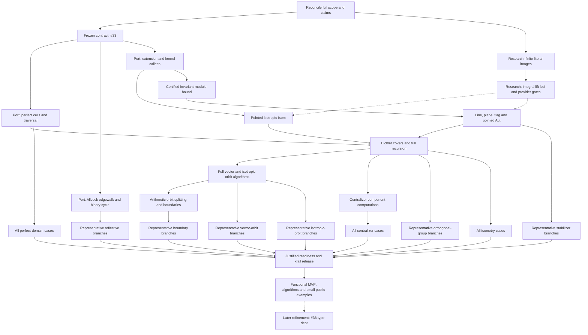

# Remaining port work: dependency DAG

Finish the pinned indefinite-lattice port through the frozen public research operations.
Functional MVP completion requires working general implementations, their assigned
generic callees, real public consumers, and small independently checkable examples
for the implemented mathematical branches. The user's 2026-10-22 MVP directive
supersedes older full-file, type, performance and refinement gates in this DAG.
Keep every frozen fixture and the complete CI workflow; its long-tail failures
remain evidence for later work and do not gate functional publication. A known
missing general branch remains an implementation obligation.
Post-v1 functionality stays open with its required results recorded, including
cases for which the pinned upstream supplies no implementation.

The [issue tree rooted at #4](https://github.com/dzackgarza/sage-indefinite-port/issues/4) owns implementation claims, issue dependencies, and acceptance.
The nodes below decompose that contract; they do not replace it, and they
are not narrowed by the next action in `.tmp/HANDOFF.md`.
An unchecked node is a remaining obligation, not a claim that its implementation is absent: subtract the implementation already present before authoring.

Read the specific TODO node selected by the tracked handoff; do not
re-survey this DAG at every turn. Change a node when actual acceptance
evidence (commit, CI case IDs and run), or a demonstrated issue obligation,
changes its status or contract.

## Sources, scope, and execution constraints

- Read the [port design](references/port-design.md), its [concrete assignments](references/port-design.md#implementation-assignments), and the [translation map](references/source-to-sage-translation-map.md) for the node you take up.
  Read each pinned routine and its called helpers before changing its port.

- Algorithm authority: `references/vendor/Indefinite.jl@374a5ebb`, `references/vendor/polyhedral_common@1592b246`, and the Allcock paper in `references/vendor/arxiv/2110.03784/`. Obtain missing pinned source.
  Never compile the C++ reference or substitute a different algorithm, bounded heuristic, or basis-dependent shortcut for its general route.

- Port source: the published `implement/lorentzian-completion` branch.
  Research provider: the published `dzackgarza/research` main commit recorded by
  each Acceptance run. Do not modify another checkout or assume the remote
  research branch equals a former local worktree.

- Research owns independent extension, kernel, equation, module, finite-action, and gluing computations.
  This port owns specialized search, compatibility-action construction, arithmetic image discovery, recursion, and assembly.
  A missing provider is recorded with its exact independent contract and failed consumer; independent port authoring continues against the frozen API.

- Public values are the preamble's lattice, element, morphism, homset, and tensor objects.
  Pointed markings are fixed in the coslice; sublattices use the arrow category; flags use `Fun([2], Lattices)`. Preserve these different Isom/Aut questions.
  Keep raw engine coordinates inside their owners; add no local carriers, facades, stubs, `Any` escapes, suppressions, or `sys.path` edits.

- The port acceptance suite is frozen.
  A necessary API or case change belongs to #33, with its reason recorded before adopting it.
  Scratch probes never replace frozen cases and are not prerequisites for remote execution.

- Runs, commits, and gates follow AGENTS.md: acceptance runs in CI on every push; local runs check one case; commit and push every edit.
  Port module paths below are relative to `src/sage_indefinite_port/`; research module paths are relative to `src/dzack_research/preamble/`.

The live port issues #33, #15, #18, and #36 are open.
Their blocked-by edges impose `#33 → #15 → #18 → #36`, with additional direct prerequisites from #33 to #18/#36 and from #15 to #36. Closed historical leaves retain their original obligations where absorbed into these issues.

## Dependency graph

An arrow means the predecessor supplies a required result.
Solid arrows describe port/contract dependencies.
Dotted arrows describe provider results required for acceptance; they are **not** research-to-port issue blocking edges.
Independent port bodies can be authored against the frozen provider names.
Graph parallelism never permits concurrent Sage runs or competing writers in one tree.

Run each family once its algorithm and provider prerequisites are available, rather than waiting for all other families.
Final closure rechecks every family at the final revisions.

## Contract and provider nodes

- [ ] **SCOPE — Reconcile the original obligation and live ownership.** Done once, by one agent, and recorded here; it is not a per-turn activity.
  Read #4 and every leaf's original acceptance, including absorbed #19–#23/#31 and the historical corpus requirements, and map every remaining obligation to a node below, extending this DAG where one is absent.
  Reconcile relevant unmerged **remote branches** (`port/cells`,
  `port/edgewalk`, `port/eichler`, `port/parabolic`,
  `finish/handoff-remainder`, `implement/pinned-indefinite-reduction`)
  against the integration branch without treating branch names as active-worker
  assignments. Account for applicable mathematical deltas, not detached local worktrees.

- [ ] **CONTRACT — Establish the #33 prerequisite.
  Depends on SCOPE.** Verify that the source-backed corpus, frozen API, suite, and concrete ownership assignments satisfy #33's contract, including its original corpus extraction requirements.
  Resolve outstanding contract work through #33 without weakening any assertion.
  Its acceptance is a coherent frozen proof boundary; successful algorithms and all consumer results remain separate obligations below.

- [ ] **FINITE — Exact images of finite literal sets.
  Owner: research #401.** The reported failure: squaring literal `{1,2,3}` could not compute image cardinality, in `_ImageSetEngine` of `categories/sets/set_categories.py`. `_FiniteLiteralSet` has explicit finite points without a selected ordinal enumeration; the repair must preserve that distinction, undecided equality, and inverse-domain admission, and must never enumerate an arbitrary merely-finite set or invent a ranking.
  Verify the current **published research provider commit** against the
  stated test contracts; a previous repair commit is not acceptance evidence.
  Acceptance: on the research provider commit, both research nodes pass with their mathematical assertions: `tests/sets/test_injections_surjections_and_subsets_of_finite_sets.sage::test_injection_inverse_on_image_and_characteristic_are_compatible` and `tests/constructions/test_sets_construct.sage::test_subsets_by_condition_and_by_image`.

- [ ] **LIFTS — Integral-lift provider.
  Depends on FINITE; owner: research #401.** The integral restriction of the rational lift locus must be correct in both regimes: the nonempty locus preserves the marked vector and rejects nonintegral or incorrect lifts; the locus between U and U(2) is empty.
  The coisotropic Witt extension and pointwise-perpendicular kernel contracts
  used below are part of this node. Use current committed research consumers
  and executable cases; prior local probe scripts/logs are not required.
  The port records the failing consumer and the provider commit; the repair itself is research's.

## Port algorithm nodes

Each node retains the pinned algorithm's branches, invariants, enumeration scope, termination, and certificates.
Read the source and account for representation or callee substitutions before authoring.
A mathematical deviation needs a source-backed proof or counterexample on its owning issue before adoption.

| Node / owner | Required predecessors | Required result and proof obligation |
| --- | --- | --- |
| **CELLS / #15** | CONTRACT | Finish initial positive-vector/perfect-cell search, scaled shell/sphere multiplier search, exact flip bounds, flips, finite configuration actions, side pairings, and the complete quotient traversal in `indefinite/lorentzian_cells.py` and its helpers. Preserve both total and isotropic modes and marked-cell data. Read `Lorentzian.g:315–429,705–968,971–1232,1239–1371` and `IndefiniteFormsFundamental.g:11–30`. Discharge A_PERFECT. |
| **EDGEWALK / #15** | CONTRACT | Finish Allcock starting corners, cusp and candidate-root steps, next-wall selection, reflectivity/termination, and the oriented binary cycle in `indefinite/edgewalk.py` and `edgewalk_extensions.py`. Follow the pinned implementation and vendored paper. Verify `canonical_companion`, `promised_step`, `shorter_pair`, `reduced_start_pair`, and `anisotropic_cycle`; the copied binary cycle and first-success scaled search belong here in the port. Generic fixed-bound arithmetic stays in research. Discharge A_REFLECTIVE, retaining all applicable equivalence/stabilizer datasets. |
| **EXTEND / #18** | CONTRACT | Verify the current integration in `indefinite/recursive.py` (`_IsotropicExtension`) through owned partial isometries and `partial.witt_extension(source_inclusion,target_inclusion)`, plus `R.pointwise_perpendicular_kernel().group_generators()`. Preserve the source's Euclidean-nullspace complement; do not substitute an arbitrary complement. Convert the complete kernel family `1+T_j` to `1+T_j/d` through rational morphisms; justify the scaling using `T_i T_j=0`, since each direction kills `N=I-perp` and has image in `I⊆N`. Retain the port's `Hom(K,I)` shears. Keep raw engine coordinates inside the tensor owner. Verify both the assigned provider calls and their complete use by the general route. |
| **POINTED / #18** | EXTEND | Verify and repair the existing `_isotropic_pointed_isometry` route using primitive markings, recursive reduction Isom, and `R.rational_lifts(S,reduced).integral_members()`. Preserve rational/integral base-point handling, the full target correction assembly when one reduced map has an empty integral fibre (an empty fibre for one reduced map does not make the whole Isom empty), and upstream's global-sign normalization against the actual marked vectors. Repair the general route beyond the even divisibility-one shortcut. Discharge the relevant A_ISOMETRY/A_STABILIZERS cases and invalid/nonisometric examples. |
| **BOUND / #18** | EXTEND | In `isotropic_stabilizer_action` and `isotropic_subspace_isometry`, retain the certified bound `D=2 d² e² a`: `d` is the source period/common generator denominator, `e` the absolute reduction discriminant, and `a=|coker(L→I*)|` the intrinsic pairing index. Construct that pairing with owned dualization and `metric_map` after checking their contracts. The finite-cokernel index is now computed exactly from the product of nonzero Smith entries of the full-row-rank integral pairing matrix, rather than provider `index()`/`cardinality()` dispatch. Targeted regressions pass for divisibility-four isotropic lines and rank-two planes in `U(4)⊕U(4)`, and for div-1/div-2 pointed stabilizer routes (`.tmp/isotropic-stabilizer-regressions-6b9116c-20261025T152931Z.log`, port `6b9116cf`). The full bound/containment predecessor remains open: the provider's later finite-representation transporter still fails when it requests cardinality of a represented finite torsion module. Use the recorded line/plane/flag bound proof, the complete orbit-generated module, and its containment certificate; do not truncate the orbit or use a coordinate-complement determinant for `a`. |
| **PARABOLIC / #18** | BOUND | Implement/verify `IsotropicInduction.line_automorphism_generators`, `plane_automorphism_generators`, `flag_automorphism_generators`, and isotropic `EichlerRecursion.pointed_automorphism_generators`. Supply recursive reduced groups, compatibility actions, arithmetic image discovery, and assembly of appropriate sections and kernels. Distinguish the pointwise-perpendicular kernel from the joint-action kernel. Calling the same unresolved parabolic `.group_generators()` is circular. Discharge A_STABILIZERS and the line/plane/flag portions of A_ISOTROPIC. |
| **RECURSION / #18** | POINTED, PARABOLIC, CELLS | Finish/verify `EichlerEnvelope`, `OrbitCoverModel` approximate generators, prescribed-invariant covers, splitting vectors, full orthogonal-group assembly, and Isom decisions. Supply the rational generated group, inclusion, and applicability proof to research's `IntegralStructureAction`; retain exact witnesses and full fibres. Recheck direct-sum factors, transvection signs, content corrections, primitive-in-L versus primitive-in-envelope coverage, and the earlier Eichler `[-1]` repair. The current scaled-dual isometry (replacing the old mass/group-based qfisom emptiness path), reduced-dual full-group and cached fixed-map preimage implementations are the routes to verify; do not revive obsolete diagnoses of their predecessors. Discharge A_GROUPS/A_ISOMETRY. |
| **ORBITS / #18** | RECURSION | Finish all fixed-norm vector and rank-at-most-two isotropic line/plane/flag classification: finite double-coset actions, saturation, exact identifications, representatives, stabilizers, and witnesses. Trace the full pinned dispatcher for zero/negative norms, spacelike cases, and higher-index Eichler covers. A restriction in one Lorentzian helper does not prove a project-wide source gap. Obtain missing headers and preserve the existing full orbit scopes. Discharge A_VECTORS/A_ISOTROPIC. |
| **ARITHMETIC / #18** | ORBITS | Supply ambient indefinite groups, orbits, stabilizers, and finite discriminant/character actions to generic preimage and orbit-splitting computations. Reconstruct subgroup representatives, witnesses, stabilizers, and boundary labels; verify coinvariant extension and selected enumeration. Retain all absorbed #19–#22 obligations. Discharge A_BOUNDARIES and the arithmetic subgroup cases elsewhere in the suite. |
| **CENTRALIZERS / #18** | RECURSION | Supply the indefinite component orthogonal-group computations to research's invariant-decomposition and compatible-gluing construction. Verify every finite-order frozen case, including discriminant images. For a non-scalar component, identify its actual computational route and hypotheses; full component O(L) or a subgroup predicate is insufficient. Research #397 owns its independent computation; #18 retains the full consumer obligation. Discharge A_CENTRALIZERS. |
| **PERFORMANCE / #18** | Deferred until functional MVP | Do not profile, benchmark, optimize or tune runtime during this phase. If an essential small correctness example cannot execute, repair its immediate correctness/importability defect and resume implementation. Preserve expensive cases for later CI-reported work. |

EXTEND, POINTED, and BOUND use the existing [source/callee correspondence and bound proof](https://github.com/dzackgarza/sage-indefinite-port/issues/18#issuecomment-6217015400).
Its source anchors are `Lorentzian.g:115–249`, `Fundamental.g:471–516,751–794`, and `IndefiniteForms.g:988–1055,1605–1650`. The correspondence is an implementation obligation, not proof that current code implements it.

## Frozen acceptance nodes

The historical case requirements below remain the full regression obligations.
They are not functional MVP completion or publication gates. Current MVP evidence
uses small real consumers with independent answers, exact witnesses, and recorded
port/provider revisions; retain uncovered branches explicitly.

A node is accepted at an exact committed revision using the complete criterion
specified in its row. For the families covered by [#33's October 22
amendment](https://github.com/dzackgarza/sage-indefinite-port/issues/33#issuecomment-6343829665),
cite a branch-representative set of *unchanged* case IDs exercising every
algorithm branch, including the ranks/signatures where it branches, and record
covered and uncovered branches, the port commit, the published research
revision, and the CI result. Exhaustive long-tail coverage does not gate those
families. `A_PERFECT`, `A_ISOMETRY` and `A_CENTRALIZERS` retain their
explicit full-file requirements. A missing or failed shard is never reported
as passed; success of a different family does not accept this one. The full
workflow may be red from non-sampled cases; unchanged failing cases remain
recorded defects.
Only accepted cases, not uncommitted probes, helper tests or old logs, establish
a node's result.

| Node | Algorithm predecessors | Required case evidence | Accepted at |
| --- | --- | --- | --- |
| [ ] **A_PERFECT** | CELLS | [`test_perfect_domains.sage`](tests/acceptance/test_perfect_domains.sage): all 40×2 total/isotropic counts and every semantic assertion, including cases 24/26/30. The row-matrix-to-owned-isometry conversion used by Schreier facet actions has changed since the baseline; the public facet-orbit permutation/isometry regression now runs on a lattice with explicit string coordinate labels, checking each owned isometry against its internal ray permutation. Current-head certification is pending. The pinned positive-vector CVP shell now has an explicit-coordinate-label regression comparing the primitive direction, saturated kernel basis, affine center, and first shell against the default presentation. The hosted `perfect_domains` file additionally checks exact positive and isotropic first-shell rows under explicit string labels, including every returned row’s norm and timelike pairing; both branches check the pinned dual-LLL recursive enumeration order, the positive-shell test verifies that the public initial-vector search returns the same ordered first shell as the enumerator, and both positive and isotropic shells are now checked again after a genuine Gram/basis permutation, with the public initial-vector consumer required to return exactly the ordered first shell produced by the enumerator. It verifies that halving the rational direction while halving its pairing bound preserves the exact first shell after the pinned linear scale conversion. | Baseline [Acceptance run 40807218493](https://github.com/dzackgarza/sage-indefinite-port/actions/runs/40807218493), port `f7285d7bb533efb3eab591ee4ee0f66df987c15b`, research `6e4078ea446ceec30f0ce8afc0bab7863387fac9`: all 8 shards succeeded, 86 JUnit cases, 0 failures/errors/skips. That run does not certify the changed row-matrix conversion. Current branch Acceptance is pending at latest push. |
| [ ] **A_REFLECTIVE** | EDGEWALK | [`test_reflective.sage`](tests/acceptance/test_reflective.sage): the baseline branch sample covers `allcock_rk3_4` (signature (2,1), Gram `[[0,-1,0],[-1,0,0],[0,0,1]]`, isotropic cusp), `allcock_rk3_2` (signature (2,1), Gram `[[-3,0,0],[0,1,0],[0,0,1]]`, rationally anisotropic start), `U+<2>` finite/ideal corners, `U+<46>` nonreflective stop after three vertex orbits, the compact hexagon `[-1] + [[3,1],[1,7]]`, rank-two signature-(1,1) forms `diag(1,-2)` and `U`, and the polyhedral_common `ListSimpleRootSystem_0` root-system oracle. The same sample job includes OSCAR Vinberg and E10 root-system comparisons. The push sample now also checks the binary period-action matrix in explicit coordinate-label order, including a genuinely permuted diagonal Gram presentation; edgewalk identity/isometry keys and the accumulated fixed-lattice invariant likewise use the coordinate-label frame rather than `module_generators()` enumeration, with a unit regression on explicit labels. The Vinberg and isotropic edgewalk row bases, constrained-subspace rows, and Vinberg translation-class breadth-first basis now derive from coordinate labels as well, with a unit probe for the shared basis helper. The compact-hexagon branch is rerun on a genuinely permuted Gram/basis presentation with explicit string labels and its labelled-coordinate root graph is compared with the default presentation. These sit alongside the exact rank-two coordinate/period certificates for `[[1,1],[1,-1]]` and `diag(2,-1)`; the latter cycle is also checked after swapping its Gram/basis coordinates, comparing the complete representative set back in the default frame. These added nodes are pending current-head Acceptance. | Baseline [Acceptance run 40807218493](https://github.com/dzackgarza/sage-indefinite-port/actions/runs/40807218493), port `f7285d7bb533efb3eab591ee4ee0f66df987c15b`, research `6e4078ea446ceec30f0ce8afc0bab7863387fac9`: `reflective 0/1` succeeded, 3/3 nodes, 0 failures/errors/skips. The added nodes are included in the current branch Acceptance workflow; hosted Sage results are pending. The baseline run does not certify these assertions. Exact baseline coverage and limitations are recorded in [#15](https://github.com/dzackgarza/sage-indefinite-port/issues/15#issuecomment-6487939750). Exhaustive 8,821-form, 103-root-system, and full rank-three execution is long-tail and gates nothing ([#33 amendment](https://github.com/dzackgarza/sage-indefinite-port/issues/33#issuecomment-6343829665)). |
| [ ] **A_GROUPS** | RECURSION | [`test_orthogonal_group.sage`](tests/acceptance/test_orthogonal_group.sage): the push sample includes `LORENTZ_OrthogonalGroup0` with recorded generator images, Mertens, the hyperbolic-plane order, discriminant-image branches, and degenerate forms `diag(2,0)`, `diag(2,0,0)`, and the zero rank-two form (radical GL and shear assembly). The rank-two radical cases assert the exact nonsingular-to-radical shear and a nontrivial radical `GL_2(Z)` action; the totally radical case with non-lexical labels explicitly requires an elementary `GL_2(Z)` shear, a signed coordinate swap, and an improper generator. Full-file coverage is long-tail and gates nothing ([#33 amendment](https://github.com/dzackgarza/sage-indefinite-port/issues/33#issuecomment-6343829665)). The new degenerate branches are included in the current branch Acceptance workflow; their hosted Sage results are pending. | — |
| [ ] **A_ISOMETRY** | RECURSION | [`test_isometry.sage`](tests/acceptance/test_isometry.sage): baseline 158-case evidence includes the applicable 145 equivalences and three stabilizer datasets, positive/negative decisions, SPLAG (51a)/(51b), binary forms, and basis covariance. Added coordinate-boundary regressions: equal-Gram coordinate identification with deliberately permuted source/target labels, a degenerate non-diagonal-complement isometry witness with independently permuted source/target string labels, and row-/column-matrix morphism round trips using nontrivial exact isometries, with the deliberately reversed `(right,left)` source label order asserted at the consumer. The odd-lattice Eichler-envelope branch now has a hosted test using both the original and a genuinely permuted Gram/basis presentation with explicitly ordered labels; each run checks the exact scale-two even envelope, the similarity Gram identity, and integrality of all images. The GRPeasy and full source-generator-matrix families are also checked on a represented 2U model whose even complement has non-lexical labels: every returned generator must preserve the appropriate represented-model Gram form, and GRPeasy must contain the independent sign reversal of each anisotropic rank-one complement block. Current-head verification is pending. | Baseline [Acceptance run 40807218493](https://github.com/dzackgarza/sage-indefinite-port/actions/runs/40807218493), port `f7285d7bb533efb3eab591ee4ee0f66df987c15b`, research `6e4078ea446ceec30f0ce8afc0bab7863387fac9`: all 8 shards succeeded, 158 JUnit cases, 0 failures/errors/skips. All four additions are pending current-head Acceptance; the baseline run does not certify them. `ci-provision-sage` pins the tested research API revision. |
| [ ] **A_STABILIZERS** | PARABOLIC | [`test_vector_stabilizers.sage`](tests/acceptance/test_vector_stabilizers.sage): a branch-representative sample of the 17 cases, recorded by case id, including r_-1 through r_8, OSCAR, and E10 squares 0/2/4/6/8/10. The plane/flag stabilizer consumer now exercises `IsotropicInduction.plane_vectors` on a lattice with deliberately non-lexical string labels, and asserts the declared label order is retained. Full coverage is long-tail and gates nothing ([#33 amendment](https://github.com/dzackgarza/sage-indefinite-port/issues/33#issuecomment-6343829665)). | — |
| [ ] **A_VECTORS** | ORBITS | [`test_vector_orbits.sage`](tests/acceptance/test_vector_orbits.sage): a branch-representative sample, recorded by case id, including DH/E10 counts and representatives, every E10 case, higher-index/spacelike obligations, and the nonsplit rank-two signature-(1,1) branch `test_anisotropic_binary_vector_classes_use_primitive_embeddings` (zero-square emptiness and primitive fixed-norm classes through the exact binary orbit transversal). Full-file coverage is long-tail and gates nothing ([#33 amendment](https://github.com/dzackgarza/sage-indefinite-port/issues/33#issuecomment-6343829665)). | — |
| [ ] **A_ISOTROPIC** | ORBITS | [`test_isotropic_orbits.sage`](tests/acceptance/test_isotropic_orbits.sage): a branch-representative sample with complete line, plane and flag assembly at the recorded parabolic indices. Plane basis extraction now follows the inclusion-domain coordinate-label order; the plane/flag stabilizer consumer regression is included in the `vector_stabilizers` push sample. Full 8,832-case coverage is long-tail coverage and gates nothing ([#33 amendment](https://github.com/dzackgarza/sage-indefinite-port/issues/33#issuecomment-6343829665)). Preserve DH parabolic indices 1/527, stable-subgroup line/plane counts 528/24242, and recorded flag counts wherever asserted. | — |
| [ ] **A_BOUNDARIES** | ARITHMETIC | [`test_boundaries.sage`](tests/acceptance/test_boundaries.sage): a branch-representative sample of the 119 cases, recorded by case id, including Dawes, Enriques, D-tower, Scattone/root labels, degree-2/4 K3, and polarization cases at their frozen locations. Full coverage is long-tail and gates nothing ([#33 amendment](https://github.com/dzackgarza/sage-indefinite-port/issues/33#issuecomment-6343829665)). | — |
| [x] **A_CENTRALIZERS** | CENTRALIZERS | [`test_centralizers.sage`](tests/acceptance/test_centralizers.sage): all five cases and full #18 discriminant-image assertions, including recorded orders 96/24192/72/2 where applicable. | [Acceptance run 40807218493](https://github.com/dzackgarza/sage-indefinite-port/actions/runs/40807218493), port `f7285d7bb533efb3eab591ee4ee0f66df987c15b`, research `6e4078ea446ceec30f0ce8afc0bab7863387fac9`: the full-file job succeeded, 5 JUnit cases, 0 failures/errors/skips. `ci-provision-sage` pins the tested research API revision, and the source and acceptance cases are unchanged at the current port head. |

Diagnose discrepancies at their precise source step. Do not change a frozen
case or drop an assertion to form the cited evidence sample.

## Functional MVP evidence from the current implementation work

**V1 functional status: the pinned algorithm routes are implemented.** The
algorithm families and public consumers below have small
independently justified examples. Full historical acceptance and refinement
remain separate obligations, together with the post-v1 functional backlog.
The lower-rational-Witt-index cases are still required functionality. Their
inherited source limitation makes them post-v1 work; it does not remove them
from the project. The open requirements and implementation context follow
the evidence table.

The latest functional repairs are published in port
`666d5a50cd3501aca5ee07eb04f7e2bcabfcc672` and research
`ec87ab857183f91d5fa03ed1a6e2678667763411`. They complete the native Vinberg
starting-corner route, public radical Aut/Isom dispatch and base cases,
selected marked/arithmetic stabilizer generators, finite-character
intersection cosets, coslice subgroup transporters, and owned split
isotropic witnesses. Earlier verified changes are in port
`59227592439cdccd859e9282bc02ced2a977a3c4` and research
`2024cb764e4e28ceb818f82f2b1075291ce83a68`, including provider publications
`fdcd0208`, `6659a043` and `dee0024c`. The examples below
were run as the individual fixes landed, through the real public consumers
unless a private arithmetic check is explicitly identified. They are not a
complete acceptance run on one final revision. Frozen tests and the full
Acceptance workflow remain unchanged.

| Capability | Small independently justified evidence |
| --- | --- |
| Perfect domains | Frozen `Result_Enumeration_0` and `_1`: respectively one and two total cells, one isotropic cell each, with completion and group certificates. |
| Allcock EDGEWALK | `U+<2>` and `diag(-3,1,1)` produce the independently recorded three-wall Gram tables; the examples exercise finite and ideal corners and the anisotropic binary cycle. |
| Nontrivial starting corner and nonreflectivity | The compact hexagon `[-1] + [[3,1],[1,7]]` starts with a rootless perpendicular and returns the six-wall Gram from pinned Allcock Weyl group 123, lattice 9. `U+<46>` returns a nonreflective certificate after three vertices; its integral symmetry has fixed Gram `[3/46]`, with no timelike fixed vector. |
| Orthogonal groups and integral isometries | `O(2U)` and `O(2U+<-2>)` have mod-3 images of orders 1152 and 103680; generators preserve the form and have integral inverses. A changed-basis isometry has an exact witness, while opposite parity obstructs isometry. `O(diag(1,-2))` has the expected Pell-generated mod-3 dihedral image of order 8. |
| Radical Aut/Isom | Public `Isom(<2>+0, [[2,2],[2,2]])` returns an integral unimodular witness; `<2>+0` versus `<4>+0` is empty. The public groups of `<2>+0`, `U+0`, and `0^2` have mod-3 image orders 12, 72, and 48, as required by the split-radical semidirect product. |
| Parabolic and pointed constructions | The plane and flag stabilizers in `2U` have mod-3 images of orders 144 and 36. Opposite planes and flags have exact witnesses. The divisibility-four isotropic pointed example requires the full quotient-group correction when the first reduced lift is nonintegral, and returns an integral witness. |
| Vector and isotropic classes | Split `U` and higher-index `2U` have the expected zero and nonzero primitive classes. The new spacelike route on `U+<-2>` has exactly two norm-minus-two classes of divisibilities 1 and 2, with pointed witnesses; odd norm in this even lattice is empty. Rationally anisotropic `diag(2,2,-6,-6)` has empty zero-vector and isotropic-line families. |
| Rational Witt index and empty plane families | Native hyperbolic splitting returns indices 0, 1 and 2 for `diag(2,2,-6,-6)`, `U+<2,-4>` and `2U`. Public plane and flag families are empty for the first two and each have one class for `2U`. Zero and definite spaces return zero as an owned `ZZ` element. |
| Arithmetic subgroup actions | The stable subgroup splits the full-group line orbit of `U(2)` into two. The determinant-character quotient of `O(U)` has order 2; `SO(U)` has two line/cusp classes, and no subgroup transporter exchanges the coordinate lines. |
| Complete character intersections | For `Gamma = SO(2U) cap O_plus(2U)`, the character image has order 4 and the subgroup image order 1. Primitive square-minus-two vectors have one full-group and one subgroup class. A positive Eichler transporter lies in Gamma; the vector stabilizer image modulo 3 has order 12. Opposite plane rulings have no Gamma transporter. |
| Boundaries | `2U` has one point cusp, one curve cusp and one incidence. Divisibility, character label, discriminant class, quotient `U`, and the rank-zero quotient's determinant, discriminant order and empty root type all agree with the explicit model. |
| Arithmetic boundary generators | The same Gamma has one line cusp, two plane cusps and two incidences, with witnesses in Gamma. Its plane stabilizer has mod-3 image order 72. The specified split-plane quotient in `2U+A2(-1)` has signature `(0,2)`, determinant 3 and root type `A2`. |
| Centralizers and finite gluing | All five frozen centralizer cases passed at provider `6659a043`, with orders 2, 4, 72, 96 and 24192. The later general-CM implementation passes the mixed-component case based on fixture 88, still of image order 96. Nontrivial glue examples `U(2)` with a swap and `2I_3` with a 3-cycle have glue indices 2 and 3 and image orders 2 and 3. |
| General CM arithmetic | Over `Q(zeta_5)`, inert, ramified and split local quotients, the relative/absolute different distinction and the trace dual pass exact checks. The public `A4+(-A4)` Coxeter centralizer image has order 8, independently generated by explicit commuting integral isometries. |
| Native primitive embeddings | Primitive extensions of `<2>+<-2>` include the direct sum and the unimodular extension; nonprimitive glue for `<8>+<-2>` is excluded. `U(2) -> U+<8>` has two fixed-source embedding classes and one unmarked sublattice class. `<-1> -> U+<-1>` has two classes with even and odd unimodular perpendiculars, retaining the original unscaled parents. |
| Finite and lift providers | Both named frozen `FINITE` provider tests pass, including literal finite images without selecting an order and preservation of undecided equality. Public rational-lift loci have the required integral witness for the marked `U` swap and an empty integral locus for `U -> U(2)`. Coisotropic swaps, shears, a cusp configuration and a conjugated plane check exact form preservation, restrictions and integrality. |
| General indefinite isometry decisions | The native Hecke spinor-genus route decides the public Conway--Sloane (51a)/(51b) same-genus pair negatively and a changed integral basis positively. Its exact comparison-index arithmetic also passes for rational Witt indices 0 and 1; the public positive calls on those two forms use the one-spinor-genus shortcut. No rational approximation is returned as an integral witness. |

The larger `2U+A2(-1)` arithmetic orbit calculation reached the expected
character image but was stopped as an expensive example. Its full orbit
split and arithmetic Levi image are not claimed as verified here. The
smaller `2U` examples exercise the implemented character-intersection,
transporter and stabilizer routes; full frozen acceptance remains CI debt.

### Upstream applicability and post-v1 implementation context

The full pinned Julia/GAP/executable dispatch has no separate constructive
route for higher-real-index forms of rational Witt index zero or one.
`CombinedAlgorithms.h:887–1034,1078–1259,1899–1972,2542–2639` performs
reduction, radical splitting and cached equivalence before selecting its
definite, Lorentzian or approximate-model branch. The higher-index branch
calls `ApproximateModels.h:1216–1308`, which finds two rational hyperbolic
planes in the original space. The GAP `QmatExt` at
`IndefiniteForms.g:738` is a same-rank containing lattice after those planes
have been found, not an enlargement that removes this hypothesis.

These are the hypotheses of the reference algorithm, not an outstanding
translation. In the vendored
[Dutour Sikirić–Hulek paper, §§4.3–4.4](https://arxiv.org/html/2302.01679v2#S4.SS3),
Theorem 4.4 guarantees an approximate model for signature `p,q >= 2` and
dimension at least seven. Theorems 4.5–4.6 give general Aut/Isom algorithms
for `max(p,q) >= 5`; their induction reduces `min(p,q)` while retaining the
larger index, so every approximate-model stage meets Theorem 4.4. Theorem
4.8 gives general fixed-norm vector representatives for `max(p,q) >= 6`
and `min(p,q) >= 2`. Theorem 4.10 constructs isotropic subspaces by calling
that vector algorithm on the lattice and its successive reductions; it
provides no additional low-Witt branch. Smaller inputs handled by existing
definite, Lorentzian or split cases, including `2U`, remain supported.

The public failure for `diag(2,2,-6,-6)` and the absent second pair for
`U+<2,-4>` therefore record inherited applicability limits. The complete
source trace and comparison with port `bccf3dcae47bfb16a70dce73e55b7247865546f7`
found no omitted reference branch for those inputs. They do not add a new
v1 release gate. Complete support remains required as post-v1 functionality,
tracked explicitly below. The upstream findings describe the implementation
gap; they do not close it or narrow the eventual public contract.

## Post-v1 functional requirements

- [ ] **POST_V1_LOW_WITT — Complete constructive support when both real
  signature indices are at least two and the rational Witt index is zero
  or one.** Status: open; deferred until after v1. This is required
  functionality, not a discarded input class or completed item.
  Tracked in [issue #40](https://github.com/dzackgarza/sage-indefinite-port/issues/40).

  | Required capability | Remaining result |
  | --- | --- |
  | Full orthogonal groups | Compute complete integral generating families, including for `diag(2,2,-6,-6)` and `U+<2,-4>`. |
  | Integral isometry | Retain the existing exact equivalence decision and complete construction of an exact integral witness whenever equivalence holds; the Boolean spinor-genus decision does not discharge the witness requirement. |
  | Fixed-norm vector classes | Complete nonzero-norm orbit classification with the existing primitive/nonprimitive API semantics, stabilizers and transporters. |
  | Isotropic vectors and lines at Witt index one | Compute complete primitive norm-zero and isotropic-line classes, with stabilizers and exact transporters. |
  | Recursive and downstream consumers | Carry this support through marked isometries, stabilizer and orbit recursion, arithmetic subgroup splitting, boundary computations and component-centralizer constructions whenever their component or reduced lattices enter this regime. |

  Preserve the two rank-four examples above as explicit future correctness
  cases, including changed-basis witness checks. Completion requires a
  justified general construction and real public-consumer evidence, not
  merely suppressing the current failure or returning an empty result.
  The supported empty primitive norm-zero vector and isotropic-line families
  at Witt index zero and
  empty plane/flag families at Witt index below two remain valid existing
  results; they do not fulfill the constructive requirements in this table.
  The upstream applicability analysis above is retained to guide this work.

- [ ] **POST_V1_DEGENERATE_MARKINGS — Extend pointed/vector equivalence,
  stabilizers and orbit consumers to degenerate ambient lattices.**
  Tracked in [issue #41](https://github.com/dzackgarza/sage-indefinite-port/issues/41).
  The pinned GAP and C++ public vector routines require full ambient rank
  before their nonzero-norm branch. Retain the `<2> + 0` examples
  `(1,0) -> (1,1)`, the order-two stabilizer of `(1,0)`, and the distinct
  congruence outcomes `(5,1) -> (5,6)` and `(5,1) -> (5,2)` as extension
  requirements. This does not defer the supported unmarked radical
  Aut/Isom algorithms.

## Release and terminal nodes

- [ ] **RELEASE — Reconcile public capability claims.
  Depends on accepted algorithm families.** The current published source has
  **no active `@unfinished` decorators and no acceptance xfail markers**.
  Do not invent marker-removal work. Check public consumer routes and claimed
  availability against the actually accepted cases; any failing exposed
  operation is a source/provider defect, not a reason to claim readiness.
  If a marker is legitimately reintroduced under #33, justify and discharge
  it against the accepted cases. Issue closure needs the actual algorithm and
  consumer evidence, never just the absence of markers.

- [ ] **TYPES — Discharge #36 after algorithms and public consumers settle.**
  Classify remaining mypy diagnostics by their actual owners, fix port-specific
  types here and inherited type defects in the research repository under its
  own ownership. Preserve precise types; no `Any` escapes, invented stubs,
  or suppressions. Acceptance is an explicitly invoked CI type-check report
  on the accepted revision, not the syntax-only local `just test-push`.
  Type/style reports are nonblocking while implementation is underway.

- [ ] **FINAL — Close original issue #4.
  Functional MVP depends on RELEASE; TYPES is deferred.** On one final committed port revision with
  the research provider revision recorded, obtain passing results for each
  family's required cases (representative branch samples where #33 authorizes
  them, full-file cases where specified above) and the public research-to-port
  consumers, including exact witnesses and subgroup/orbit data. Preserve all
  frozen assertions and record remaining long-tail failures as outstanding
  defects, not discarded cases. Record the Acceptance run URL and case/branch
  coverage in this DAG. Local `just test-commit` and `just test-push` are
  syntax checks; `just test-ci` collects nonblocking diagnostics and is
  not a substitute for the Acceptance result.
  Close eligible issue units with `itree close` only with the required
  evidence, and reconcile issue/branch claims. #4 stays open while any
  required algorithm branch, provider contract or consumer is unresolved.
