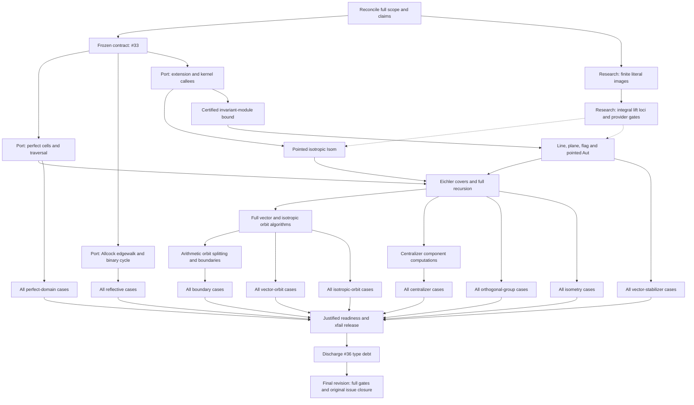

# Remaining port work: dependency DAG

Finish the entire pinned indefinite-lattice port through the frozen public research operations.
Completion requires the specialized algorithms, their assigned generic callees, every applicable upstream fixture, justified readiness release, and the terminal verification gates at the final source revisions.

This is the requested workstream-level refinement of [.tmp/HANDOFF.md](.tmp/HANDOFF.md).
The [issue tree rooted at #4](https://github.com/dzackgarza/sage-indefinite-port/issues/4) owns implementation claims, issue dependencies, and acceptance.
The nodes below decompose that contract; they do not replace it or make the handoff's current repair the whole task.
Unchecked nodes denote remaining acceptance obligations, not absent implementation.
Use current source and results to select work; historical observations below are not instructions to redo an implementation already present.

## Current execution order (owner correction, 2026-10-20)

1. Finish the selected source-mapped algorithm unit against its complete pinned routine and helper graph.
   Retain the existing source correspondence and repair missing branches together; do not discover the specification one fixture at a time.

2. Test its known failing consumer directly, then the affected family.
   A successful earlier prefix is not the next diagnostic task unless the change affects it.

3. Exercise the other independent families serially, retaining unresolved cases.
   Use full inventory runs without fail-fast.
   A diagnostic cutoff on one case must not continually suppress results from every later family.

4. Finish the remaining algorithm units and their actual provider integrations, then complete the final-source corpus, justified readiness release, and gates.

Current evidence: the October 20 run collected 26,840 cases, passed 37 perfect-domain cases, and was interrupted at Result_Enumeration_37 by its runner's 1,800-second limit.
This does not establish a mathematical failure or a runtime requirement.
The prepared retry repeats that prefix and cutoff; do not reuse it as the default validation plan.
Start with the unresolved consumer when diagnosing that route, allow a justified long run, and obtain independent family results as well.

Current source already calls partial.witt_extension, the reduction's pointwise_perpendicular_kernel, and rational_lifts(...).integral_members() in recursive.py.
EXTEND and POINTED therefore require source-correspondence and consumer verification of the existing integration, plus any concrete repairs; they are not instructions to implement those calls again.
Their presence alone does not establish the complete algorithm or provider behavior.

A diagnostic cutoff may bound an investigation, but it does not establish an acceptance budget.
Preserve any explicitly sourced owner/issue runtime requirement.
The previous 30-minute orthogonal-group claim below requires its authoritative source to be identified before it can gate acceptance; it must never be applied by analogy to perfect domains or another family.

## Sources, scope, and execution constraints

- Read [AGENTS.md](AGENTS.md), the [port design](references/port-design.md), its [concrete assignments](references/port-design.md#implementation-assignments), and the [translation map](references/source-to-sage-translation-map.md).
  Read each pinned routine and its called helpers before changing its port.

- Algorithm authority: `references/vendor/Indefinite.jl@374a5ebb`, `references/vendor/polyhedral_common@1592b246`, and the Allcock paper in `references/vendor/arxiv/2110.03784/`. Obtain missing pinned source.
  Never compile the C++ reference or substitute a different algorithm, bounded heuristic, or basis-dependent shortcut for its general route.

- Port tree: `/home/dzack/gitclones/sage-indefinite-port`. The handoff assigns the serial upstream repair interval to `/home/dzack/research/.tmp/wt-port`, branch `port/after-410`. Reconcile its ownership before resuming that interval; leave `/home/dzack/research` main and other workers' trees alone.

- Research owns independent extension, kernel, equation, module, finite-action, and gluing computations.
  This port owns specialized search, compatibility-action construction, arithmetic image discovery, recursion, and assembly.
  A missing provider is recorded with its exact independent contract and failed consumer; independent port authoring continues against the frozen API.

- Public values are the preamble's lattice, element, morphism, homset, and tensor objects.
  Pointed markings are fixed in the coslice; sublattices use the arrow category; flags use `Fun([2], Lattices)`. Preserve these different Isom/Aut questions.
  Keep raw engine coordinates inside their owners; add no local carriers, facades, stubs, `Any` escapes, suppressions, or `sys.path` edits.

- The port acceptance suite is frozen.
  Only justified capability xfail removal is allowed.
  A necessary API or case change belongs to #33, with its reason recorded before adopting it.
  Probes diagnose failures; they never replace frozen cases.

- Use one Sage mathematical process at a time.
  Detach long runs in `sage-dev-develop`, redirect output inside the container, and retain the exit status and exact source manifests.
  A timeout or interruption is not a pass.

- Diagnose a red hook/QC gate before further authoring.
  Preserve normal hooks; shared-QC lock waits do not authorize bypasses.
  No push is part of this handoff.

## Historical starting state (planning snapshot; not current work selection)

At the planning inspection, the port is on `implement/lorentzian-completion` at `84cfb96fcd4be1a91b1c00feef9b657d4600598a`; the research worktree is at `658f325328bc3cc10d2d34d0510f1b882f34bbf3`. Both have pending changes, so these commit IDs alone do not identify the runtime source.

| Tree | Pending work to preserve and verify |
| --- | --- |
| Port | `indefinite/marked_lattices.py` removes three #18 unfinished decorators; `tests/acceptance/test_centralizers.sage` removes its xfail and unused import. Keep these readiness changes uncommitted until their whole obligations pass. |
| Research worktree | `categories/isotropic_lifts.py` changes integral residue classes and the class×period inverse domain; `categories/sets/set_categories.py` guards image membership by admission to the inverse domain. These provider repairs remain unaccepted. |

Port module paths in this document are relative to `src/sage_indefinite_port/`; research module paths are relative to `src/dzack_research/preamble/` in the assigned worktree.
Preserve the unrelated untracked `.agents`, `.hermes`, `=2.18`, `cysignals_crash_logs/`, and `tests/.report/`.

The live port issues #33, #15, #18, and #36 are open.
Their blocked-by edges impose `#33 → #15 → #18 → #36`, with additional direct prerequisites from #33 to #18/#36 and from #15 to #36. Resolve any mismatch between that queue and existing branch work before selecting an implementation claim.
Closed historical leaves retain their original obligations where absorbed into these issues.

## Dependency graph

An arrow means the predecessor supplies a required result.
Solid arrows describe port/contract dependencies.
Dotted arrows describe provider results required for acceptance; they are **not** research-to-port issue blocking edges.
Independent port bodies can be authored against the frozen provider names.
Claims still obey the public issue tree, and graph parallelism never permits concurrent Sage runs or competing writers in one tree.



The detailed acceptance nodes below use the same IDs.
Run each family once its algorithm and provider prerequisites are available, rather than waiting for all other families.
Final closure rechecks every family at the final revisions.

## Contract and provider nodes

- [ ] **SCOPE — Reconcile the original obligation and live ownership.** Inspect all local branches/worktrees, remote heads, pending diffs, current jobs, and the shared claim queue before claiming or releasing work.
  Read #4 and every leaf's original acceptance, including absorbed #19–#23/#31 and the historical corpus requirements.
  Map every remaining obligation to a node below; extend this DAG if one is absent.
  Evidence is the current issue/branch correspondence and exact source manifests, not the handoff's old status or issue closure alone.

- [ ] **CONTRACT — Establish the #33 prerequisite.
  Depends on SCOPE.** Verify that the source-backed corpus, frozen API, suite, and concrete ownership assignments satisfy #33's contract, including its original corpus extraction requirements.
  Resolve outstanding contract work through #33 without weakening any assertion.
  Its acceptance is a coherent frozen proof boundary; successful algorithms and all consumer results remain separate obligations below.

- [ ] **FINITE — Repair exact images of finite literal sets.
  Depends on SCOPE; owner: research #401, assigned worktree.** Reproduce `.tmp/resume-lift-set-regressions.log`: squaring literal `{1,2,3}` cannot compute image cardinality.
  Repair `_ImageSetEngine` in `categories/sets/set_categories.py` consistently across finite image values, cardinality, injectivity, iteration, and membership.
  `_FiniteLiteralSet` has explicit finite points without a selected ordinal enumeration.
  Preserve that distinction, undecided equality, and inverse-domain admission; never try to enumerate an arbitrary merely-finite set or invent a ranking.
  Acceptance: both existing research nodes pass with their mathematical assertions: `tests/sets/test_injections_surjections_and_subsets_of_finite_sets.sage::test_injection_inverse_on_image_and_characteristic_are_compatible` and `tests/constructions/test_sets_construct.sage::test_subsets_by_condition_and_by_image`. The failing no-inverse image does not itself exercise the inverse guard.

- [ ] **LIFTS — Finish and verify the integral-lift provider.
  Depends on FINITE; owner: research #401.** Verify the complete integral restriction of the rational lift locus in both regimes: the nonempty locus preserves the marked vector and rejects nonintegral or incorrect lifts; the locus between U and U(2) is empty.
  Use the existing `.tmp/probe/resume-reduction-lift-locus.py` and `.tmp/probe/resume-empty-lift-locus.py` as diagnostic entry points, then satisfy the provider's own mathematical assertions and normal QC. Verify the coisotropic Witt extension and pointwise-perpendicular kernel contracts needed below.
  Regenerate required preamble references after source settles and commit the provider repair under research's contribution contract.
  Record its exact revision and remaining dirt.
  These results supply acceptance prerequisites, not evidence that the port consumers pass.

## Port algorithm nodes

Each node retains the pinned algorithm's branches, invariants, enumeration scope, termination, and certificates.
Read the source and account for representation or callee substitutions before authoring.
A mathematical deviation needs a source-backed proof or counterexample on its owning issue before adoption.

| Node / owner | Required predecessors | Required result and proof obligation |
| --- | --- | --- |
| **CELLS / #15** | CONTRACT | Finish initial positive-vector/perfect-cell search, scaled shell/sphere multiplier search, exact flip bounds, flips, finite configuration actions, side pairings, and the complete quotient traversal in `indefinite/lorentzian_cells.py` and its helpers. Preserve both total and isotropic modes and marked-cell data. Read `Lorentzian.g:315–429,705–968,971–1232,1239–1371` and `IndefiniteFormsFundamental.g:11–30`. Discharge A_PERFECT. |
| **EDGEWALK / #15** | CONTRACT | Finish Allcock starting corners, cusp and candidate-root steps, next-wall selection, reflectivity/termination, and the oriented binary cycle in `indefinite/edgewalk.py` and `edgewalk_extensions.py`. Follow the pinned implementation and vendored paper. Verify `canonical_companion`, `promised_step`, `shorter_pair`, `reduced_start_pair`, and `anisotropic_cycle`; the copied binary cycle and first-success scaled search belong here in the port. Generic fixed-bound arithmetic stays in research. Discharge A_REFLECTIVE, retaining all applicable equivalence/stabilizer datasets. |
| **EXTEND / #18** | CONTRACT | Verify the current integration in `indefinite/recursive.py` through owned partial isometries and `partial.witt_extension(source_inclusion,target_inclusion)`, plus `R.pointwise_perpendicular_kernel().group_generators()`. Preserve the source's Euclidean-nullspace complement. Convert the complete kernel family `1+T_j` to `1+T_j/d` through rational morphisms; justify the scaling using `T_i T_j=0`, since each direction kills `N=I-perp` and has image in `I⊆N`. Retain the port's `Hom(K,I)` shears. Verify both the assigned provider calls and their complete use by the general route. |
| **POINTED / #18** | EXTEND | Verify and repair the existing `_isotropic_pointed_isometry` route using primitive markings, recursive reduction Isom, and `R.rational_lifts(S,reduced).integral_members()`. Preserve rational/integral base-point handling, the full target correction assembly when one reduced map has an empty integral fibre, and global-sign normalization against the actual marked vectors. Repair the general route beyond the even divisibility-one shortcut. Discharge the relevant A_ISOMETRY/A_STABILIZERS cases and invalid/nonisometric examples. |
| **BOUND / #18** | EXTEND | In `isotropic_stabilizer_action` and `isotropic_subspace_isometry`, retain the certified bound `D=2 d² e² a`: `d` is the source period/common generator denominator, `e` the absolute reduction discriminant, and `a=|coker(L→I*)|` the intrinsic pairing index. Construct that pairing with owned dualization and `metric_map` after checking their contracts. Use the recorded line/plane/flag bound proof, the complete orbit-generated module, and its containment certificate; do not truncate the orbit or use a coordinate-complement determinant for `a`. |
| **PARABOLIC / #18** | BOUND | Implement/verify `IsotropicInduction.line_automorphism_generators`, `plane_automorphism_generators`, `flag_automorphism_generators`, and isotropic `EichlerRecursion.pointed_automorphism_generators`. Supply recursive reduced groups, compatibility actions, arithmetic image discovery, and assembly of appropriate sections and kernels. Distinguish the pointwise-perpendicular kernel from the joint-action kernel. Calling the same unresolved parabolic `.group_generators()` is circular. Discharge A_STABILIZERS and the line/plane/flag portions of A_ISOTROPIC. |
| **RECURSION / #18** | POINTED, PARABOLIC, CELLS | Finish/verify `EichlerEnvelope`, `OrbitCoverModel` approximate generators, prescribed-invariant covers, splitting vectors, full orthogonal-group assembly, and Isom decisions. Supply the rational generated group, inclusion, and applicability proof to research's `IntegralStructureAction`; retain exact witnesses and full fibres. Recheck direct-sum factors, transvection signs, content corrections, primitive-in-L versus primitive-in-envelope coverage, and the earlier Eichler `[-1]` repair. Verify current scaled-dual isometry and reduced-dual group paths before reviving obsolete diagnoses. Discharge A_GROUPS/A_ISOMETRY. |
| **ORBITS / #18** | RECURSION | Finish all fixed-norm vector and rank-at-most-two isotropic line/plane/flag classification: finite double-coset actions, saturation, exact identifications, representatives, stabilizers, and witnesses. Trace the full pinned dispatcher for zero/negative norms, spacelike cases, and higher-index Eichler covers. A restriction in one Lorentzian helper does not prove a project-wide source gap. Obtain missing headers and preserve the existing full orbit scopes. Discharge A_VECTORS/A_ISOTROPIC. |
| **ARITHMETIC / #18** | ORBITS | Supply ambient indefinite groups, orbits, stabilizers, and finite discriminant/character actions to generic preimage and orbit-splitting computations. Reconstruct subgroup representatives, witnesses, stabilizers, and boundary labels; verify coinvariant extension and selected enumeration. Retain all absorbed #19–#22 obligations. Discharge A_BOUNDARIES and the arithmetic subgroup cases elsewhere in the suite. |
| **CENTRALIZERS / #18** | RECURSION | Supply the indefinite component orthogonal-group computations to research's invariant-decomposition and compatible-gluing construction. Verify every finite-order frozen case, including discriminant images. For a non-scalar component, identify its actual computational route and hypotheses; full component O(L) or a subgroup predicate is insufficient. Research #397 owns its independent computation; #18 retains the full consumer obligation. Discharge A_CENTRALIZERS. |
| **PERFORMANCE / #18** | Conditional diagnostic within the affected algorithm unit | Investigate a demonstrated source divergence, repeated computation, resource failure, or violation of an explicitly sourced runtime requirement. A diagnostic timeout alone establishes none of these. The historical 30-minute/2153-second comparison needs its authoritative budget source before it is treated as a failure. Verify all 536 required generator images and complete every E10 consumer; performance investigation is not a blanket predecessor of those results. |

EXTEND, POINTED, and BOUND use the existing [source/callee correspondence and bound proof](https://github.com/dzackgarza/sage-indefinite-port/issues/18#issuecomment-6217015400), also in [.tmp/probe/extension-callee-correspondence.md](.tmp/probe/extension-callee-correspondence.md).
Its source anchors are `Lorentzian.g:115–249`, `Fundamental.g:471–516,751–794`, and `IndefiniteForms.g:988–1055,1605–1650`. The correspondence is an implementation obligation, not proof that current code implements it.
Dispatcher reading copies are `.tmp/probe/pinned-combined-algorithms.h`, `pinned-lorentzian-perfect.h`, and `pinned-approximate-models.h`.

## Frozen acceptance nodes

Every row requires its named algorithm predecessors and only the provider operations its consumers actually use.
LIFTS is not a prerequisite for every family.
Record both repositories' revisions and source hashes with each run.
The suite and source-backed assertions govern; the handoff's population counts below are scope checks, not new assertions or permission to omit additional cases.
Early diagnosis may target one failure, but node completion requires its full file.

| Node | Algorithm predecessors | Full acceptance and unresolved evidence |
| --- | --- | --- |
| [ ] **A_PERFECT** | CELLS | [`test_perfect_domains.sage`](tests/acceptance/test_perfect_domains.sage): all 40×2 total/isotropic counts and every semantic assertion, including unresolved cases 24/26/30. |
| [ ] **A_REFLECTIVE** | EDGEWALK | [`test_reflective.sage`](tests/acceptance/test_reflective.sage): all 17,526 reflective/root/chamber cases and applicable Allcock, polyhedral_common, OSCAR, and E10 expectations. Preserve the related 145 equivalence and three stabilizer datasets at their frozen locations. |
| [ ] **A_GROUPS** | RECURSION | [`test_orthogonal_group.sage`](tests/acceptance/test_orthogonal_group.sage): the whole file, including `LORENTZ_OrthogonalGroup0` and all 536 recorded generator images, plus any explicitly sourced runtime requirement. |
| [ ] **A_ISOMETRY** | RECURSION | [`test_isometry.sage`](tests/acceptance/test_isometry.sage): all 158 cases, including the applicable 145 equivalences and three stabilizer datasets, positive/negative decisions, SPLAG (51a)/(51b), binary forms, and basis covariance. Earlier killed runs do not establish a result. |
| [ ] **A_STABILIZERS** | PARABOLIC | [`test_vector_stabilizers.sage`](tests/acceptance/test_vector_stabilizers.sage): all 17 cases, including r_-1 through r_8, OSCAR, and E10 squares 0/2/4/6/8/10. Earlier reflection and square-0 evidence needs a final-source rerun; squares 2/4/6/8/10 remain unaccepted. |
| [ ] **A_VECTORS** | ORBITS | [`test_vector_orbits.sage`](tests/acceptance/test_vector_orbits.sage): the full file, including DH/E10 counts and representatives, every E10 case, and higher-index/spacelike obligations. The E10 timeout remains unresolved. |
| [ ] **A_ISOTROPIC** | ORBITS | [`test_isotropic_orbits.sage`](tests/acceptance/test_isotropic_orbits.sage): all 8,832 cases with complete line/plane/flag assembly. Preserve DH parabolic indices 1/527, stable-subgroup line/plane counts 528/24242, and recorded flag counts wherever asserted. |
| [ ] **A_BOUNDARIES** | ARITHMETIC | [`test_boundaries.sage`](tests/acceptance/test_boundaries.sage): all 119 cases, including Dawes, Enriques, D-tower, Scattone/root labels, degree-2/4 K3, and all 87 polarization cases at their frozen locations. The interrupted boundary run completed no cases. |
| [ ] **A_CENTRALIZERS** | CENTRALIZERS | [`test_centralizers.sage`](tests/acceptance/test_centralizers.sage): all five cases and full #18 discriminant-image assertions, including recorded orders 96/24192/72/2 where applicable. Earlier five-case evidence is bound to older source. |

No node is accepted by xfail, skipped cases, counts alone, a local helper probe, or a provider repair.
Diagnose any discrepancy at the precise source step and rerun affected acceptance after the correction.

## Release and terminal nodes

- [ ] **RELEASE — Release only proven capabilities.
  Depends on all A_* nodes.** Recount every `@unfinished` and xfail against current source; the handoff's old count of 46 is not current evidence.
  Map each marker to its whole obligation, remove justified markers, and verify ordinary consumer execution without `--runxfail`. Commit the pending `marked_lattices.py` and centralizer-test readiness changes only when their full claims hold.
  Each #15/#18 issue closure must cite its actual complete acceptance and committed source; marker removal does not replace missing algorithm or ownership work.

- [ ] **TYPES — Discharge #36. Depends on RELEASE and accepted #15/#18.** On settled interfaces, classify every remaining mypy error by its actual owner; fix local algorithm types here and inherited defects in their owning repository under its QC and exclusive worktree ownership.
  No suppressions, `Any`, casts, or fake stubs.
  Acceptance: `just test-push` passes mypy and #36's last commit removes the deferred-type-checking rule from `AGENTS.md`. Until then, any later authorized push exception must satisfy the exact existing `MYPY-DEFER-7Q4K` trailer/count contract; an import crash or other gate failure never qualifies.

- [ ] **FINAL — Prove and close the original #4 result.
  Depends on TYPES.** Run the complete frozen suite and required `just test-commit`, `just test-push`, and `just test-ci` gates on the final committed port revision with the exact research dependency revision recorded.
  Rerun acceptance affected by type or provider edits; earlier-source logs cannot certify the final source.
  Discharge every existing `[unverified]` contract and verify every original leaf obligation, public research-to-port entry point, witness, fixture family, and marker.
  Close eligible issue units through `itree close` with their evidence and reconcile the claim/queue on release.
  #4 stays open while any required implementation, provider behavior, acceptance case, or gate remains unresolved.

## Run and evidence reference

For implementation selection, reconcile state and use `uvx --from git+https://github.com/dzackgarza/itree itree next dzackgarza/sage-indefinite-port`. Use the assigned research worktree's source, not `/home/dzack/research/src`:

```text
PYTHONPATH=/home/dzack/ai-review-ci/tool-artifacts/pytest_plugins:/home/dzack/gitclones/sage-indefinite-port/src:/home/dzack/gitclones/sage-indefinite-port:/home/dzack/research/.tmp/wt-port/src:/home/dzack/research/.venv/lib/python3.14/site-packages
```

On this host Docker is installed via Snap at `/snap/bin/docker`, not `/usr/bin/docker`. Invoke it through `/usr/bin/sg docker -c '/snap/bin/docker ...'`. The `sage-dev-develop` container is already running; the repository `.envrc` configures the Sage, Python, preparser and Julia bridge launchers for the central QC scripts.
Long runs use `docker exec -d -u root -w /home/dzack/gitclones/sage-indefinite-port sage-dev-develop sh -c '...'`, with the export, uniquely named log, and exit-code recording inside that shell.
For a complete family or inventory run, use the existing consumer nodes without fail-fast:

```sh
/usr/bin/sage -python -c 'import sage.all,sys,pytest; sys.exit(pytest.main(sys.argv[1:]))' -p qc_sage_session NODE --runxfail -vv --tb=long
```

Replace `NODE` by the existing full file or acceptance directory.
For diagnosis, select the exact failing node; do not rerun the earlier passing prefix to reach it.
Apply a timeout only for an explicitly bounded diagnostic or a sourced acceptance requirement.
Keep diagnostic interruptions unresolved and exercise other independent families serially.
Terminal acceptance still uses the normal gates, complete inventory and released markers; interrupted or partial runs do not discharge it.
Research's earlier `--no-time-gates` probes do not discharge normal time gates.
Check the previous job's actual exit before starting another.
For research hooks, put `TMPDIR=/home/dzack/research/.tmp/wt-port/.tmp` inside the `sg` shell so container preparse can see it.

Earlier diagnostic evidence remains in `.tmp/`: `resume-r0-integrated.log`, `resume-reflection-r_1.log` through `resume-reflection-r_8.log`, `resume-r-minus1-preimage.log`, `resume-centralizers.log`, `resume-stabilizers-oscar.log`, `resume-stabilizers-e10-0.log`, `resume-reduction-lift-locus-after-2.log`, and `probe/lorog0.log`. `resume-centralizers-source.sha256` and `resume-r-minus1-preimage-source.sha256` bind only their original runs.
Keep these logs intact; create new evidence for new source and do not restart an old runner as proof of current acceptance.
