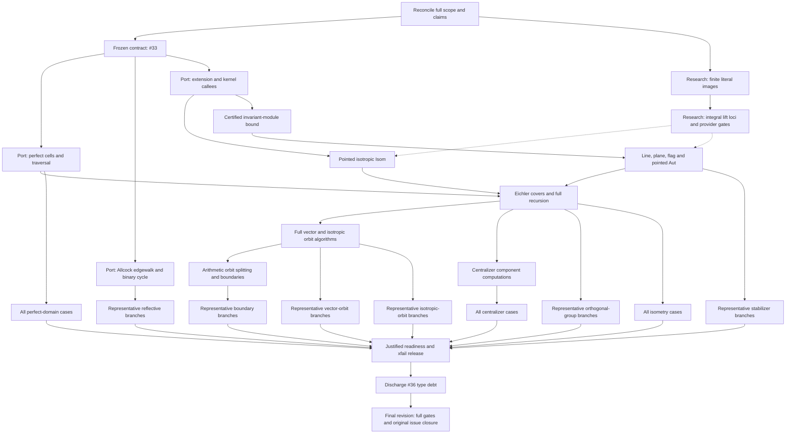

# Remaining port work: dependency DAG

Finish the pinned indefinite-lattice port through the frozen public research operations.
Completion requires the specialized algorithms, their assigned generic callees, the unchanged
upstream fixtures and the case evidence required by the accepted #33 criteria, plus final
public consumers and settled type debt. Exhaustive long-tail case coverage is not a
development completion gate for families with branch-representative sampling.

The [issue tree rooted at #4](https://github.com/dzackgarza/sage-indefinite-port/issues/4) owns implementation claims, issue dependencies, and acceptance.
The nodes below decompose that contract; they do not replace it, and they
are not narrowed by the next action in `.tmp/HANDOFF.md`.
An unchecked node is a remaining obligation, not a claim that its implementation is absent: subtract the implementation already present before authoring.

Read the specific TODO node selected by the tracked handoff; do not
re-survey this DAG at every turn. Change a node when actual acceptance
evidence (commit, CI case IDs and run), or a demonstrated issue obligation,
changes its status or contract.

## Sources, scope, and execution constraints

- Read the [port design](references/port-design.md), its [concrete assignments](references/port-design.md#implementation-assignments), and the [translation map](references/source-to-sage-translation-map.md) for the node you take up.
  Read each pinned routine and its called helpers before changing its port.

- Algorithm authority: `references/vendor/Indefinite.jl@374a5ebb`, `references/vendor/polyhedral_common@1592b246`, and the Allcock paper in `references/vendor/arxiv/2110.03784/`. Obtain missing pinned source.
  Never compile the C++ reference or substitute a different algorithm, bounded heuristic, or basis-dependent shortcut for its general route.

- Port source: the published `implement/lorentzian-completion` branch.
  Research provider: the published `dzackgarza/research` main commit recorded by
  each Acceptance run. Do not modify another checkout or assume the remote
  research branch equals a former local worktree.

- Research owns independent extension, kernel, equation, module, finite-action, and gluing computations.
  This port owns specialized search, compatibility-action construction, arithmetic image discovery, recursion, and assembly.
  A missing provider is recorded with its exact independent contract and failed consumer; independent port authoring continues against the frozen API.

- Public values are the preamble's lattice, element, morphism, homset, and tensor objects.
  Pointed markings are fixed in the coslice; sublattices use the arrow category; flags use `Fun([2], Lattices)`. Preserve these different Isom/Aut questions.
  Keep raw engine coordinates inside their owners; add no local carriers, facades, stubs, `Any` escapes, suppressions, or `sys.path` edits.

- The port acceptance suite is frozen.
  A necessary API or case change belongs to #33, with its reason recorded before adopting it.
  Scratch probes never replace frozen cases and are not prerequisites for remote execution.

- Runs, commits, and gates follow AGENTS.md: acceptance runs in CI on every push; local runs check one case; commit and push every edit.
  Port module paths below are relative to `src/sage_indefinite_port/`; research module paths are relative to `src/dzack_research/preamble/`.

The live port issues #33, #15, #18, and #36 are open.
Their blocked-by edges impose `#33 → #15 → #18 → #36`, with additional direct prerequisites from #33 to #18/#36 and from #15 to #36. Closed historical leaves retain their original obligations where absorbed into these issues.

## Dependency graph

An arrow means the predecessor supplies a required result.
Solid arrows describe port/contract dependencies.
Dotted arrows describe provider results required for acceptance; they are **not** research-to-port issue blocking edges.
Independent port bodies can be authored against the frozen provider names.
Graph parallelism never permits concurrent Sage runs or competing writers in one tree.

Run each family once its algorithm and provider prerequisites are available, rather than waiting for all other families.
Final closure rechecks every family at the final revisions.

## Contract and provider nodes

- [ ] **SCOPE — Reconcile the original obligation and live ownership.** Done once, by one agent, and recorded here; it is not a per-turn activity.
  Read #4 and every leaf's original acceptance, including absorbed #19–#23/#31 and the historical corpus requirements, and map every remaining obligation to a node below, extending this DAG where one is absent.
  Reconcile relevant unmerged **remote branches** (`port/cells`,
  `port/edgewalk`, `port/eichler`, `port/parabolic`,
  `finish/handoff-remainder`, `implement/pinned-indefinite-reduction`)
  against the integration branch without treating branch names as active-worker
  assignments. Account for applicable mathematical deltas, not detached local worktrees.

- [ ] **CONTRACT — Establish the #33 prerequisite.
  Depends on SCOPE.** Verify that the source-backed corpus, frozen API, suite, and concrete ownership assignments satisfy #33's contract, including its original corpus extraction requirements.
  Resolve outstanding contract work through #33 without weakening any assertion.
  Its acceptance is a coherent frozen proof boundary; successful algorithms and all consumer results remain separate obligations below.

- [ ] **FINITE — Exact images of finite literal sets.
  Owner: research #401.** The reported failure: squaring literal `{1,2,3}` could not compute image cardinality, in `_ImageSetEngine` of `categories/sets/set_categories.py`. `_FiniteLiteralSet` has explicit finite points without a selected ordinal enumeration; the repair must preserve that distinction, undecided equality, and inverse-domain admission, and must never enumerate an arbitrary merely-finite set or invent a ranking.
  Verify the current **published research provider commit** against the
  stated test contracts; a previous repair commit is not acceptance evidence.
  Acceptance: on the research provider commit, both research nodes pass with their mathematical assertions: `tests/sets/test_injections_surjections_and_subsets_of_finite_sets.sage::test_injection_inverse_on_image_and_characteristic_are_compatible` and `tests/constructions/test_sets_construct.sage::test_subsets_by_condition_and_by_image`.

- [ ] **LIFTS — Integral-lift provider.
  Depends on FINITE; owner: research #401.** The integral restriction of the rational lift locus must be correct in both regimes: the nonempty locus preserves the marked vector and rejects nonintegral or incorrect lifts; the locus between U and U(2) is empty.
  The coisotropic Witt extension and pointwise-perpendicular kernel contracts
  used below are part of this node. Use current committed research consumers
  and executable cases; prior local probe scripts/logs are not required.
  The port records the failing consumer and the provider commit; the repair itself is research's.

## Port algorithm nodes

Each node retains the pinned algorithm's branches, invariants, enumeration scope, termination, and certificates.
Read the source and account for representation or callee substitutions before authoring.
A mathematical deviation needs a source-backed proof or counterexample on its owning issue before adoption.

| Node / owner | Required predecessors | Required result and proof obligation |
| --- | --- | --- |
| **CELLS / #15** | CONTRACT | Finish initial positive-vector/perfect-cell search, scaled shell/sphere multiplier search, exact flip bounds, flips, finite configuration actions, side pairings, and the complete quotient traversal in `indefinite/lorentzian_cells.py` and its helpers. Preserve both total and isotropic modes and marked-cell data. Read `Lorentzian.g:315–429,705–968,971–1232,1239–1371` and `IndefiniteFormsFundamental.g:11–30`. Discharge A_PERFECT. |
| **EDGEWALK / #15** | CONTRACT | Finish Allcock starting corners, cusp and candidate-root steps, next-wall selection, reflectivity/termination, and the oriented binary cycle in `indefinite/edgewalk.py` and `edgewalk_extensions.py`. Follow the pinned implementation and vendored paper. Verify `canonical_companion`, `promised_step`, `shorter_pair`, `reduced_start_pair`, and `anisotropic_cycle`; the copied binary cycle and first-success scaled search belong here in the port. Generic fixed-bound arithmetic stays in research. Discharge A_REFLECTIVE, retaining all applicable equivalence/stabilizer datasets. |
| **EXTEND / #18** | CONTRACT | Verify the current integration in `indefinite/recursive.py` (`_IsotropicExtension`) through owned partial isometries and `partial.witt_extension(source_inclusion,target_inclusion)`, plus `R.pointwise_perpendicular_kernel().group_generators()`. Preserve the source's Euclidean-nullspace complement; do not substitute an arbitrary complement. Convert the complete kernel family `1+T_j` to `1+T_j/d` through rational morphisms; justify the scaling using `T_i T_j=0`, since each direction kills `N=I-perp` and has image in `I⊆N`. Retain the port's `Hom(K,I)` shears. Keep raw engine coordinates inside the tensor owner. Verify both the assigned provider calls and their complete use by the general route. |
| **POINTED / #18** | EXTEND | Verify and repair the existing `_isotropic_pointed_isometry` route using primitive markings, recursive reduction Isom, and `R.rational_lifts(S,reduced).integral_members()`. Preserve rational/integral base-point handling, the full target correction assembly when one reduced map has an empty integral fibre (an empty fibre for one reduced map does not make the whole Isom empty), and upstream's global-sign normalization against the actual marked vectors. Repair the general route beyond the even divisibility-one shortcut. Discharge the relevant A_ISOMETRY/A_STABILIZERS cases and invalid/nonisometric examples. |
| **BOUND / #18** | EXTEND | In `isotropic_stabilizer_action` and `isotropic_subspace_isometry`, retain the certified bound `D=2 d² e² a`: `d` is the source period/common generator denominator, `e` the absolute reduction discriminant, and `a=|coker(L→I*)|` the intrinsic pairing index. Construct that pairing with owned dualization and `metric_map` after checking their contracts. Use the recorded line/plane/flag bound proof, the complete orbit-generated module, and its containment certificate; do not truncate the orbit or use a coordinate-complement determinant for `a`. |
| **PARABOLIC / #18** | BOUND | Implement/verify `IsotropicInduction.line_automorphism_generators`, `plane_automorphism_generators`, `flag_automorphism_generators`, and isotropic `EichlerRecursion.pointed_automorphism_generators`. Supply recursive reduced groups, compatibility actions, arithmetic image discovery, and assembly of appropriate sections and kernels. Distinguish the pointwise-perpendicular kernel from the joint-action kernel. Calling the same unresolved parabolic `.group_generators()` is circular. Discharge A_STABILIZERS and the line/plane/flag portions of A_ISOTROPIC. |
| **RECURSION / #18** | POINTED, PARABOLIC, CELLS | Finish/verify `EichlerEnvelope`, `OrbitCoverModel` approximate generators, prescribed-invariant covers, splitting vectors, full orthogonal-group assembly, and Isom decisions. Supply the rational generated group, inclusion, and applicability proof to research's `IntegralStructureAction`; retain exact witnesses and full fibres. Recheck direct-sum factors, transvection signs, content corrections, primitive-in-L versus primitive-in-envelope coverage, and the earlier Eichler `[-1]` repair. The current scaled-dual isometry (replacing the old mass/group-based qfisom emptiness path), reduced-dual full-group and cached fixed-map preimage implementations are the routes to verify; do not revive obsolete diagnoses of their predecessors. Discharge A_GROUPS/A_ISOMETRY. |
| **ORBITS / #18** | RECURSION | Finish all fixed-norm vector and rank-at-most-two isotropic line/plane/flag classification: finite double-coset actions, saturation, exact identifications, representatives, stabilizers, and witnesses. Trace the full pinned dispatcher for zero/negative norms, spacelike cases, and higher-index Eichler covers. A restriction in one Lorentzian helper does not prove a project-wide source gap. Obtain missing headers and preserve the existing full orbit scopes. Discharge A_VECTORS/A_ISOTROPIC. |
| **ARITHMETIC / #18** | ORBITS | Supply ambient indefinite groups, orbits, stabilizers, and finite discriminant/character actions to generic preimage and orbit-splitting computations. Reconstruct subgroup representatives, witnesses, stabilizers, and boundary labels; verify coinvariant extension and selected enumeration. Retain all absorbed #19–#22 obligations. Discharge A_BOUNDARIES and the arithmetic subgroup cases elsewhere in the suite. |
| **CENTRALIZERS / #18** | RECURSION | Supply the indefinite component orthogonal-group computations to research's invariant-decomposition and compatible-gluing construction. Verify every finite-order frozen case, including discriminant images. For a non-scalar component, identify its actual computational route and hypotheses; full component O(L) or a subgroup predicate is insufficient. Research #397 owns its independent computation; #18 retains the full consumer obligation. Discharge A_CENTRALIZERS. |
| **PERFORMANCE / #18** | Conditional, inside the affected algorithm node | Investigate only a demonstrated source divergence, repeated computation, resource failure, or violation of an explicitly sourced runtime requirement, with a profile or `faulthandler` stack from the actual failing case. A timeout alone establishes none of these; neither does the historical 30-minute/2153-second orthogonal-group comparison, whose budget has no authoritative source. For E10, profile the current committed path on the actually failing
consumer (the 536 generator images where applicable); relevant generic
computations include family sections, fixed-map Smith preimages, isometry
equality and finite-action word sections. The timed consumer and the 536 generator images decide whether performance is fixed. |

EXTEND, POINTED, and BOUND use the existing [source/callee correspondence and bound proof](https://github.com/dzackgarza/sage-indefinite-port/issues/18#issuecomment-6217015400).
Its source anchors are `Lorentzian.g:115–249`, `Fundamental.g:471–516,751–794`, and `IndefiniteForms.g:988–1055,1605–1650`. The correspondence is an implementation obligation, not proof that current code implements it.

## Frozen acceptance nodes

A node is accepted at an exact committed revision using the complete criterion
specified in its row. For the families covered by [#33's October 22
amendment](https://github.com/dzackgarza/sage-indefinite-port/issues/33#issuecomment-6343829665),
cite a branch-representative set of *unchanged* case IDs exercising every
algorithm branch, including the ranks/signatures where it branches, and record
covered and uncovered branches, the port commit, the published research
revision, and the CI result. Exhaustive long-tail coverage does not gate those
families. `A_PERFECT`, `A_ISOMETRY` and `A_CENTRALIZERS` retain their
explicit full-file requirements. A missing or failed shard is never reported
as passed; success of a different family does not accept this one. The full
workflow may be red from non-sampled cases; unchanged failing cases remain
recorded defects.
Only accepted cases, not uncommitted probes, helper tests or old logs, establish
a node's result.

| Node | Algorithm predecessors | Required case evidence | Accepted at |
| --- | --- | --- | --- |
| [x] **A_PERFECT** | CELLS | [`test_perfect_domains.sage`](tests/acceptance/test_perfect_domains.sage): all 40×2 total/isotropic counts and every semantic assertion, including cases 24/26/30. | `30799df`, research `0a70597c04`: [Acceptance run 39667397208](https://github.com/dzackgarza/sage-indefinite-port/actions/runs/39667397208), all 8 shards, 80 passed |
| [ ] **A_REFLECTIVE** | EDGEWALK | [`test_reflective.sage`](tests/acceptance/test_reflective.sage): a branch-representative sample of the reflective/root/chamber cases covering each branch of the pinned edgewalk (starting corners, cusp and candidate-root step, next-wall selection, binary cycle), recorded by case id, and applicable Allcock, polyhedral_common, OSCAR, and E10 expectations. Full 17,526-case coverage is long-tail coverage and gates nothing ([#33 amendment](https://github.com/dzackgarza/sage-indefinite-port/issues/33#issuecomment-6343829665)). Preserve the related 145 equivalence and three stabilizer datasets at their frozen locations. | — |
| [ ] **A_GROUPS** | RECURSION | [`test_orthogonal_group.sage`](tests/acceptance/test_orthogonal_group.sage): a branch-representative sample of the file, including `LORENTZ_OrthogonalGroup0` and its recorded generator images, plus any explicitly sourced runtime requirement. Full-file coverage is long-tail coverage and gates nothing ([#33 amendment](https://github.com/dzackgarza/sage-indefinite-port/issues/33#issuecomment-6343829665)). | — |
| [ ] **A_ISOMETRY** | RECURSION | [`test_isometry.sage`](tests/acceptance/test_isometry.sage): all 158 cases, including the applicable 145 equivalences and three stabilizer datasets, positive/negative decisions, SPLAG (51a)/(51b), binary forms, and basis covariance. | — |
| [ ] **A_STABILIZERS** | PARABOLIC | [`test_vector_stabilizers.sage`](tests/acceptance/test_vector_stabilizers.sage): a branch-representative sample of the 17 cases, recorded by case id, including r_-1 through r_8, OSCAR, and E10 squares 0/2/4/6/8/10. Full coverage is long-tail and gates nothing ([#33 amendment](https://github.com/dzackgarza/sage-indefinite-port/issues/33#issuecomment-6343829665)). | — |
| [ ] **A_VECTORS** | ORBITS | [`test_vector_orbits.sage`](tests/acceptance/test_vector_orbits.sage): a branch-representative sample, recorded by case id, including DH/E10 counts and representatives, every E10 case, and higher-index/spacelike obligations. Full-file coverage is long-tail and gates nothing ([#33 amendment](https://github.com/dzackgarza/sage-indefinite-port/issues/33#issuecomment-6343829665)). | — |
| [ ] **A_ISOTROPIC** | ORBITS | [`test_isotropic_orbits.sage`](tests/acceptance/test_isotropic_orbits.sage): a branch-representative sample with complete line, plane and flag assembly at the recorded parabolic indices. Full 8,832-case coverage is long-tail coverage and gates nothing ([#33 amendment](https://github.com/dzackgarza/sage-indefinite-port/issues/33#issuecomment-6343829665)). Preserve DH parabolic indices 1/527, stable-subgroup line/plane counts 528/24242, and recorded flag counts wherever asserted. | — |
| [ ] **A_BOUNDARIES** | ARITHMETIC | [`test_boundaries.sage`](tests/acceptance/test_boundaries.sage): a branch-representative sample of the 119 cases, recorded by case id, including Dawes, Enriques, D-tower, Scattone/root labels, degree-2/4 K3, and polarization cases at their frozen locations. Full coverage is long-tail and gates nothing ([#33 amendment](https://github.com/dzackgarza/sage-indefinite-port/issues/33#issuecomment-6343829665)). | — |
| [ ] **A_CENTRALIZERS** | CENTRALIZERS | [`test_centralizers.sage`](tests/acceptance/test_centralizers.sage): all five cases and full #18 discriminant-image assertions, including recorded orders 96/24192/72/2 where applicable. | — |

Diagnose discrepancies at their precise source step. Do not change a frozen
case or drop an assertion to form the cited evidence sample.

## Release and terminal nodes

- [ ] **RELEASE — Reconcile public capability claims.
  Depends on accepted algorithm families.** The current published source has
  **no active `@unfinished` decorators and no acceptance xfail markers**.
  Do not invent marker-removal work. Check public consumer routes and claimed
  availability against the actually accepted cases; any failing exposed
  operation is a source/provider defect, not a reason to claim readiness.
  If a marker is legitimately reintroduced under #33, justify and discharge
  it against the accepted cases. Issue closure needs the actual algorithm and
  consumer evidence, never just the absence of markers.

- [ ] **TYPES — Discharge #36 after algorithms and public consumers settle.**
  Classify remaining mypy diagnostics by their actual owners, fix port-specific
  types here and inherited type defects in the research repository under its
  own ownership. Preserve precise types; no `Any` escapes, invented stubs,
  or suppressions. Acceptance is an explicitly invoked CI type-check report
  on the accepted revision, not the syntax-only local `just test-push`.
  Type/style reports are nonblocking while implementation is underway.

- [ ] **FINAL — Close original issue #4.
  Depends on RELEASE and TYPES.** On one final committed port revision with
  the research provider revision recorded, obtain passing results for each
  family's required cases (representative branch samples where #33 authorizes
  them, full-file cases where specified above) and the public research-to-port
  consumers, including exact witnesses and subgroup/orbit data. Preserve all
  frozen assertions and record remaining long-tail failures as outstanding
  defects, not discarded cases. Record the Acceptance run URL and case/branch
  coverage in this DAG. Local `just test-commit` and `just test-push` are
  syntax checks; `just test-ci` collects nonblocking diagnostics and is
  not a substitute for the Acceptance result.
  Close eligible issue units with `itree close` only with the required
  evidence, and reconcile issue/branch claims. #4 stays open while any
  required algorithm branch, provider contract or consumer is unresolved.
