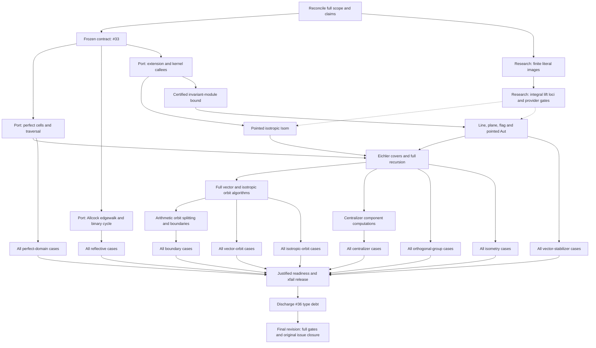

# Remaining port work: dependency DAG

Finish the entire pinned indefinite-lattice port through the frozen public research operations.
Completion requires the specialized algorithms, their assigned generic callees, every applicable upstream fixture, justified readiness release, and the terminal verification gates at the final source revisions.

The [issue tree rooted at #4](https://github.com/dzackgarza/sage-indefinite-port/issues/4) owns implementation claims, issue dependencies, and acceptance.
The nodes below decompose that contract; they do not replace it, and they are not narrowed by whatever `.tmp/HANDOFF.md` is currently doing.
An unchecked node is a remaining obligation, not a claim that its implementation is absent: subtract the implementation already present before authoring.

This file is not read at the start of a turn.
`.tmp/HANDOFF.md` Now names the node being worked; read that node's row here when you take it up.
This file changes only to record an acceptance (commit and Acceptance run URL, as in AGENTS.md "Running Sage") or to add an obligation found in an issue body that the DAG lacks.

## Sources, scope, and execution constraints

- Read the [port design](references/port-design.md), its [concrete assignments](references/port-design.md#implementation-assignments), and the [translation map](references/source-to-sage-translation-map.md) for the node you take up.
  Read each pinned routine and its called helpers before changing its port.

- Algorithm authority: `references/vendor/Indefinite.jl@374a5ebb`, `references/vendor/polyhedral_common@1592b246`, and the Allcock paper in `references/vendor/arxiv/2110.03784/`. Obtain missing pinned source.
  Never compile the C++ reference or substitute a different algorithm, bounded heuristic, or basis-dependent shortcut for its general route.
  Dispatcher reading copies are `.tmp/probe/pinned-combined-algorithms.h`, `pinned-lorentzian-perfect.h`, and `pinned-approximate-models.h`.

- Port tree: `/home/dzack/gitclones/sage-indefinite-port`. Research provider: committed `HEAD` of `/home/dzack/research` main, snapshotted per run.
  The former repair worktree `/home/dzack/research/.tmp/wt-port` (branch `port/after-410`) no longer exists on disk; its branch survives in research and was not merged into main.
  Leave `/home/dzack/research` and other workers' trees alone (AGENTS.md "Working against the frozen API").

- Research owns independent extension, kernel, equation, module, finite-action, and gluing computations.
  This port owns specialized search, compatibility-action construction, arithmetic image discovery, recursion, and assembly.
  A missing provider is recorded with its exact independent contract and failed consumer; independent port authoring continues against the frozen API.

- Public values are the preamble's lattice, element, morphism, homset, and tensor objects.
  Pointed markings are fixed in the coslice; sublattices use the arrow category; flags use `Fun([2], Lattices)`. Preserve these different Isom/Aut questions.
  Keep raw engine coordinates inside their owners; add no local carriers, facades, stubs, `Any` escapes, suppressions, or `sys.path` edits.

- The port acceptance suite is frozen.
  Only justified capability xfail removal is allowed.
  A necessary API or case change belongs to #33, with its reason recorded before adopting it.
  Probes diagnose failures; they live in `.tmp/probe/` and never replace frozen cases.

- Runs, commits, and gates follow AGENTS.md: acceptance runs in CI on every push; local runs check one case; commit and push every edit.
  Port module paths below are relative to `src/sage_indefinite_port/`; research module paths are relative to `src/dzack_research/preamble/`.

The live port issues #33, #15, #18, and #36 are open.
Their blocked-by edges impose `#33 → #15 → #18 → #36`, with additional direct prerequisites from #33 to #18/#36 and from #15 to #36. Closed historical leaves retain their original obligations where absorbed into these issues.

## Dependency graph

An arrow means the predecessor supplies a required result.
Solid arrows describe port/contract dependencies.
Dotted arrows describe provider results required for acceptance; they are **not** research-to-port issue blocking edges.
Independent port bodies can be authored against the frozen provider names.
Graph parallelism never permits concurrent Sage runs or competing writers in one tree.

Run each family once its algorithm and provider prerequisites are available, rather than waiting for all other families.
Final closure rechecks every family at the final revisions.

## Contract and provider nodes

- [ ] **SCOPE — Reconcile the original obligation and live ownership.** Done once, by one agent, and recorded here; it is not a per-turn activity.
  Read #4 and every leaf's original acceptance, including absorbed #19–#23/#31 and the historical corpus requirements, and map every remaining obligation to a node below, extending this DAG where one is absent.
  Inspect the local branches and worktrees that may hold unmerged port work (`finish/handoff-remainder` at `.tmp/wt-handoff`, `implement/pinned-indefinite-reduction` at `.tmp/wt-pinned-reduction`, `chore/ambient-audit`) and record here whether each is merged, superseded, or owed.

- [ ] **CONTRACT — Establish the #33 prerequisite.
  Depends on SCOPE.** Verify that the source-backed corpus, frozen API, suite, and concrete ownership assignments satisfy #33's contract, including its original corpus extraction requirements.
  Resolve outstanding contract work through #33 without weakening any assertion.
  Its acceptance is a coherent frozen proof boundary; successful algorithms and all consumer results remain separate obligations below.

- [ ] **FINITE — Exact images of finite literal sets.
  Owner: research #401 (research's own worker).** The historical failure: squaring literal `{1,2,3}` could not compute image cardinality (`.tmp/resume-lift-set-regressions.log`), in `_ImageSetEngine` of `categories/sets/set_categories.py`. `_FiniteLiteralSet` has explicit finite points without a selected ordinal enumeration; the repair must preserve that distinction, undecided equality, and inverse-domain admission, and must never enumerate an arbitrary merely-finite set or invent a ranking.
  Research main now carries `2687e575da fix: count literal finite sets and rational rank-one isometries at their owners`; whether it discharges this node is unverified.
  Acceptance: on the research provider commit, both research nodes pass with their mathematical assertions: `tests/sets/test_injections_surjections_and_subsets_of_finite_sets.sage::test_injection_inverse_on_image_and_characteristic_are_compatible` and `tests/constructions/test_sets_construct.sage::test_subsets_by_condition_and_by_image`.

- [ ] **LIFTS — Integral-lift provider.
  Depends on FINITE; owner: research #401.** The integral restriction of the rational lift locus must be correct in both regimes: the nonempty locus preserves the marked vector and rejects nonintegral or incorrect lifts; the locus between U and U(2) is empty.
  Diagnostic entry points: `.tmp/probe/resume-reduction-lift-locus.py` (evidence `resume-reduction-lift-locus-after-2.log`) and the unrun `.tmp/probe/resume-empty-lift-locus.py`. The coisotropic Witt extension and pointwise-perpendicular kernel contracts used below are part of this node.
  The port records the failing consumer and the provider commit; the repair itself is research's.

## Port algorithm nodes

Each node retains the pinned algorithm's branches, invariants, enumeration scope, termination, and certificates.
Read the source and account for representation or callee substitutions before authoring.
A mathematical deviation needs a source-backed proof or counterexample on its owning issue before adoption.

| Node / owner | Required predecessors | Required result and proof obligation |
| --- | --- | --- |
| **CELLS / #15** | CONTRACT | Finish initial positive-vector/perfect-cell search, scaled shell/sphere multiplier search, exact flip bounds, flips, finite configuration actions, side pairings, and the complete quotient traversal in `indefinite/lorentzian_cells.py` and its helpers. Preserve both total and isotropic modes and marked-cell data. Read `Lorentzian.g:315–429,705–968,971–1232,1239–1371` and `IndefiniteFormsFundamental.g:11–30`. Discharge A_PERFECT. |
| **EDGEWALK / #15** | CONTRACT | Finish Allcock starting corners, cusp and candidate-root steps, next-wall selection, reflectivity/termination, and the oriented binary cycle in `indefinite/edgewalk.py` and `edgewalk_extensions.py`. Follow the pinned implementation and vendored paper. Verify `canonical_companion`, `promised_step`, `shorter_pair`, `reduced_start_pair`, and `anisotropic_cycle`; the copied binary cycle and first-success scaled search belong here in the port. Generic fixed-bound arithmetic stays in research. Discharge A_REFLECTIVE, retaining all applicable equivalence/stabilizer datasets. |
| **EXTEND / #18** | CONTRACT | Verify the current integration in `indefinite/recursive.py` (`_IsotropicExtension`) through owned partial isometries and `partial.witt_extension(source_inclusion,target_inclusion)`, plus `R.pointwise_perpendicular_kernel().group_generators()`. Preserve the source's Euclidean-nullspace complement; do not substitute an arbitrary complement. Convert the complete kernel family `1+T_j` to `1+T_j/d` through rational morphisms; justify the scaling using `T_i T_j=0`, since each direction kills `N=I-perp` and has image in `I⊆N`. Retain the port's `Hom(K,I)` shears. Keep raw engine coordinates inside the tensor owner. Verify both the assigned provider calls and their complete use by the general route. |
| **POINTED / #18** | EXTEND | Verify and repair the existing `_isotropic_pointed_isometry` route using primitive markings, recursive reduction Isom, and `R.rational_lifts(S,reduced).integral_members()`. Preserve rational/integral base-point handling, the full target correction assembly when one reduced map has an empty integral fibre (an empty fibre for one reduced map does not make the whole Isom empty), and upstream's global-sign normalization against the actual marked vectors. Repair the general route beyond the even divisibility-one shortcut. Discharge the relevant A_ISOMETRY/A_STABILIZERS cases and invalid/nonisometric examples. |
| **BOUND / #18** | EXTEND | In `isotropic_stabilizer_action` and `isotropic_subspace_isometry`, retain the certified bound `D=2 d² e² a`: `d` is the source period/common generator denominator, `e` the absolute reduction discriminant, and `a=|coker(L→I*)|` the intrinsic pairing index. Construct that pairing with owned dualization and `metric_map` after checking their contracts. Use the recorded line/plane/flag bound proof, the complete orbit-generated module, and its containment certificate; do not truncate the orbit or use a coordinate-complement determinant for `a`. |
| **PARABOLIC / #18** | BOUND | Implement/verify `IsotropicInduction.line_automorphism_generators`, `plane_automorphism_generators`, `flag_automorphism_generators`, and isotropic `EichlerRecursion.pointed_automorphism_generators`. Supply recursive reduced groups, compatibility actions, arithmetic image discovery, and assembly of appropriate sections and kernels. Distinguish the pointwise-perpendicular kernel from the joint-action kernel. Calling the same unresolved parabolic `.group_generators()` is circular. Discharge A_STABILIZERS and the line/plane/flag portions of A_ISOTROPIC. |
| **RECURSION / #18** | POINTED, PARABOLIC, CELLS | Finish/verify `EichlerEnvelope`, `OrbitCoverModel` approximate generators, prescribed-invariant covers, splitting vectors, full orthogonal-group assembly, and Isom decisions. Supply the rational generated group, inclusion, and applicability proof to research's `IntegralStructureAction`; retain exact witnesses and full fibres. Recheck direct-sum factors, transvection signs, content corrections, primitive-in-L versus primitive-in-envelope coverage, and the earlier Eichler `[-1]` repair. The current scaled-dual isometry (replacing the old mass/group-based qfisom emptiness path), reduced-dual full-group and cached fixed-map preimage implementations are the routes to verify; do not revive obsolete diagnoses of their predecessors. Discharge A_GROUPS/A_ISOMETRY. |
| **ORBITS / #18** | RECURSION | Finish all fixed-norm vector and rank-at-most-two isotropic line/plane/flag classification: finite double-coset actions, saturation, exact identifications, representatives, stabilizers, and witnesses. Trace the full pinned dispatcher for zero/negative norms, spacelike cases, and higher-index Eichler covers. A restriction in one Lorentzian helper does not prove a project-wide source gap. Obtain missing headers and preserve the existing full orbit scopes. Discharge A_VECTORS/A_ISOTROPIC. |
| **ARITHMETIC / #18** | ORBITS | Supply ambient indefinite groups, orbits, stabilizers, and finite discriminant/character actions to generic preimage and orbit-splitting computations. Reconstruct subgroup representatives, witnesses, stabilizers, and boundary labels; verify coinvariant extension and selected enumeration. Retain all absorbed #19–#22 obligations. Discharge A_BOUNDARIES and the arithmetic subgroup cases elsewhere in the suite. |
| **CENTRALIZERS / #18** | RECURSION | Supply the indefinite component orthogonal-group computations to research's invariant-decomposition and compatible-gluing construction. Verify every finite-order frozen case, including discriminant images. For a non-scalar component, identify its actual computational route and hypotheses; full component O(L) or a subgroup predicate is insufficient. Research #397 owns its independent computation; #18 retains the full consumer obligation. Discharge A_CENTRALIZERS. |
| **PERFORMANCE / #18** | Conditional, inside the affected algorithm node | Investigate only a demonstrated source divergence, repeated computation, resource failure, or violation of an explicitly sourced runtime requirement, with a profile or `faulthandler` stack from the actual failing case. A timeout alone establishes none of these; neither does the historical 30-minute/2153-second orthogonal-group comparison, whose budget has no authoritative source. For E10, start from `.tmp/probe/lorog0.log` and a profile of the current path; relevant generic computations include family sections, fixed-map Smith preimages, isometry equality and finite-action word sections. The timed consumer and the 536 generator images decide whether performance is fixed. |

EXTEND, POINTED, and BOUND use the existing [source/callee correspondence and bound proof](https://github.com/dzackgarza/sage-indefinite-port/issues/18#issuecomment-6217015400), also in [.tmp/probe/extension-callee-correspondence.md](.tmp/probe/extension-callee-correspondence.md).
Its source anchors are `Lorentzian.g:115–249`, `Fundamental.g:471–516,751–794`, and `IndefiniteForms.g:988–1055,1605–1650`. The correspondence is an implementation obligation, not proof that current code implements it.

## Frozen acceptance nodes

A node is accepted at commit C when every shard of its file passes in the CI Acceptance run for C (AGENTS.md "Running Sage"). Write the commit and run URL into the node's `Accepted at` cell.
Runs against uncommitted source, fail-fast runs, interrupted runs and helper probes accept nothing; they appear here only as diagnostic pointers.
The population counts are scope checks, not new assertions or permission to omit additional cases.

| Node | Algorithm predecessors | Full acceptance | Accepted at | Diagnostic history |
| --- | --- | --- | --- | --- |
| [x] **A_PERFECT** | CELLS | [`test_perfect_domains.sage`](tests/acceptance/test_perfect_domains.sage): all 40×2 total/isotropic counts and every semantic assertion, including cases 24/26/30. | `30799df`, research `0a70597c04`: [Acceptance run 39667397208](https://github.com/dzackgarza/sage-indefinite-port/actions/runs/39667397208), all 8 shards, 80 passed | `.tmp/accept-original-full-20261020i.log` (uncommitted Oct 20 source): total-mode 0–39 and isotropic 0–38 passed, stopped by its worker at isotropic 39. `.tmp/accept-perfect-final-20261021g.log` (uncommitted, `-x`): no output after total-mode 37 from 06:40 UTC Oct 21. |
| [ ] **A_REFLECTIVE** | EDGEWALK | [`test_reflective.sage`](tests/acceptance/test_reflective.sage): all 17,526 reflective/root/chamber cases and applicable Allcock, polyhedral_common, OSCAR, and E10 expectations. Preserve the related 145 equivalence and three stabilizer datasets at their frozen locations. | — | `.tmp/accept-reflective-complete-20261019.exit` = 1. |
| [ ] **A_GROUPS** | RECURSION | [`test_orthogonal_group.sage`](tests/acceptance/test_orthogonal_group.sage): the whole file, including `LORENTZ_OrthogonalGroup0` and all 536 recorded generator images, plus any explicitly sourced runtime requirement. | — | none complete. |
| [ ] **A_ISOMETRY** | RECURSION | [`test_isometry.sage`](tests/acceptance/test_isometry.sage): all 158 cases, including the applicable 145 equivalences and three stabilizer datasets, positive/negative decisions, SPLAG (51a)/(51b), binary forms, and basis covariance. | — | earlier runs killed without a usable diagnosis. |
| [ ] **A_STABILIZERS** | PARABOLIC | [`test_vector_stabilizers.sage`](tests/acceptance/test_vector_stabilizers.sage): all 17 cases, including r_-1 through r_8, OSCAR, and E10 squares 0/2/4/6/8/10. | — | `.tmp/resume-r0-integrated.log`, `resume-reflection-r_1.log`…`r_8.log`, `resume-r-minus1-preimage.log`, `resume-stabilizers-oscar.log`, `resume-stabilizers-e10-0.log` (older source); squares 2–10 never completed. |
| [ ] **A_VECTORS** | ORBITS | [`test_vector_orbits.sage`](tests/acceptance/test_vector_orbits.sage): the full file, including DH/E10 counts and representatives, every E10 case, and higher-index/spacelike obligations. | — | E10 cases never completed. |
| [ ] **A_ISOTROPIC** | ORBITS | [`test_isotropic_orbits.sage`](tests/acceptance/test_isotropic_orbits.sage): all 8,832 cases with complete line/plane/flag assembly. Preserve DH parabolic indices 1/527, stable-subgroup line/plane counts 528/24242, and recorded flag counts wherever asserted. | — | no complete run. |
| [ ] **A_BOUNDARIES** | ARITHMETIC | [`test_boundaries.sage`](tests/acceptance/test_boundaries.sage): all 119 cases, including Dawes, Enriques, D-tower, Scattone/root labels, degree-2/4 K3, and all 87 polarization cases at their frozen locations. | — | `.tmp/resume-boundaries.log` completed no cases. |
| [ ] **A_CENTRALIZERS** | CENTRALIZERS | [`test_centralizers.sage`](tests/acceptance/test_centralizers.sage): all five cases and full #18 discriminant-image assertions, including recorded orders 96/24192/72/2 where applicable. | — | `.tmp/resume-centralizers.log` (older source; `resume-centralizers-source.sha256` binds only that run). |

Diagnose any discrepancy at the precise source step.
Old logs stay intact; new evidence goes in new run directories.

## Release and terminal nodes

- [ ] **RELEASE — Release only proven capabilities.
  Depends on all A_* nodes.** Recount every `@unfinished` (`src/sage_indefinite_port/readiness.py`) and xfail against current source.
  Map each marker to its whole obligation, remove justified markers in their own commits, and verify ordinary consumer execution without `--runxfail`. Each #15/#18 issue closure must cite its actual complete acceptance and committed source; marker removal does not replace missing algorithm or ownership work.

- [ ] **TYPES — Discharge #36. Depends on RELEASE and accepted #15/#18.** On settled interfaces, classify every remaining mypy error by its actual owner; fix local algorithm types here and inherited defects in their owning repository under its QC and exclusive worktree ownership.
  No suppressions, `Any`, casts, or fake stubs.
  Acceptance: `just test-push` passes mypy and #36's last commit removes the deferred-type-checking rule from `AGENTS.md`. Until then, any authorized push exception must satisfy the exact `MYPY-DEFER-7Q4K` trailer/count contract; an import crash or other gate failure never qualifies.

- [ ] **FINAL — Prove and close the original #4 result.
  Depends on TYPES.** Require an Acceptance run in which every family passes, and `just test-commit`, `just test-push`, and `just test-ci`, on the final committed port revision with the research provider commit recorded.
  Discharge every existing `[unverified]` contract and verify every original leaf obligation, public research-to-port entry point, witness, fixture family, and marker.
  Close eligible issue units through `itree close` with their evidence and reconcile the claim/queue on release.
  #4 stays open while any required implementation, provider behavior, acceptance case, or gate remains unresolved.

## Outstanding work recorded 2026-10-22 (verbatim)

*Diagnostic record of the measured state at Acceptance run `30799df`, recorded verbatim as delivered.
The obligations remain the nodes above; this section supplies the failure counts those nodes must be judged against.*

### What's actually left

Measured from the newest completed Acceptance run (port `30799df`, research `0a70597c04`, 2026-10-21T20:06Z) — not from the TODO table, which is stale.

| Family | pass / fail | Outstanding defect |
|---|---|---|
| perfect_domains | 80 / 0 | ✅ accepted |
| isometry | 158 / 0 | ✅ passes, but TODO still shows `[ ]` |
| orthogonal_group | 7 / 0 | shard `orthogonal_group-0` produced no report (setup failure or hard timeout) — the timed consumer and 536 generator images never ran |
| isotropic_orbits | 6124 / 1 | `'PreimageSubgroups.parent_class' object has no attribute 'stabilizer'` (provider gap); 3 shards produced no report |
| boundaries | 6 / 7 | 3× `ValueError: the specified subspaces must have codimension one`; 3× `membership … is undecided; supply a word witness`; 1× `PariError: sorry, qfsolve, dim >= 10 is not yet implemented` |
| centralizers | 0 / 5 | 2× `tensor.matrix needs a ring as its first argument`; 3× finitely-presented-module membership `TypeError` |
| vector_orbits | 52 / 9 | all 9: `PariError: the PARI stack overflows` |
| vector_stabilizers | 15 / 2 | both: same PARI stack overflow |
| reflective | 493 / 17033 | three defects: 16,154× `ValueError: must be in the domain or a list, tuple or string`; 844× `TypeError: not all arguments converted during string formatting`; 35× `ValueError: must be a square matrix` |

The 17k reflective failures are **one or two bugs**, not 17,526 independent ones — all in `test_simple_root_counts_match_polyhedral_common`, concentrated in the same code path.
Same for the 11 PARI stack overflows (one sizing bug) and the 6 PARI/sublattice errors.
So the remaining work is defect-bounded, not feature-bounded: something like eight distinct defects plus two provider gaps.

### Beyond the families

- **Contract nodes:** `SCOPE` and `CONTRACT (#33)` are still unchecked, though the suite and API are clearly frozen and in use.
  `FINITE` and `LIFTS` are research-owned (#401); research main has `2687e575da` but nobody recorded whether it discharges them.

- **Provider gaps recorded in HANDOFF:** `right_coset_section` re-admission (`g_sets.py:682`), non-spanning families in `_coordinate_basis_data`, E10 orbit-span speed.

- **`TYPES` (#36):** mypy debt deferred with the `MYPY-DEFER-7Q4K` ≤1000 bound; unpayable until the families are accepted.

- **`FINAL`:** one Acceptance run at the final revision where every family passes, plus `just test-commit`, `test-push`, `test-ci`, then `itree close` on the leaf units.

- **`RELEASE` is effectively moot:** there are **zero** `@unfinished` decorators in `src/` and **zero** xfail markers in `tests/acceptance/`. Every failure above is a real failure.
  That also means the markers were released before acceptance, contrary to the release rule — worth a decision, since TODO still lists the node as open.

### State that will mislead the next worker

- `.tmp/HANDOFF.md` Now is a fossil: it names a coordinator running five agents per file and uncommitted research fixes in `/home/dzack/research/.tmp/wt-port-fix`. Those agents are dead and two of the five branches are already merged into HEAD.

- TODO's acceptance table records only `A_PERFECT`; the run above also accepted `A_ISOMETRY` (158/158) and would accept `A_GROUPS` if shard 0 reported.

- **5 commits are unpushed** (`origin/implement/lorentzian-completion..HEAD`), including the merged flag-marking work; two Acceptance runs for that branch have been sitting `pending`/`in_progress` for 5 and 8.5 hours.
  Nothing about the current revision is measured.

### The shortest correct queue

1. Kill or fix the two stalled CI runs; push is already 5 commits ahead.

2. Reflective: fix the `must be in the domain or a list, tuple or string` path first — 16,154 of 17,033 cases.

3. The PARI stack overflow (11 cases across two families) — likely one allocation/config fix.

4. Boundaries/centralizers: `codimension one`, `word witness`, `tensor.matrix` ring argument.

5. `PreimageSubgroups.stabilizer` is research's; record it there and continue.

6. Then re-run and update the TODO rows with commit + run URL.

That is a day or two of defect work plus CI latency — not another week of optimization.

### Scope update (user, 2026-10-22)

> Clearing ALL of the cases is a long-tail optimization. Clearing SOME of them as evidence of correctness is all that's really required to advance the project.

This supersedes the reading of the counts above. What it changes:

- **The failure counts measure distance to full coverage, not distance to the next unit of progress.** A representative sample that demonstrates the algorithm is correct advances the project; the remainder is long-tail coverage.
- **Reflective's 16,154-case defect is still the highest-value single fix** (it is one bug on one code path), but it is not a prerequisite for demonstrating reflectivity.
- **The frozen acceptance table is now narrower than the requirement.** `A_REFLECTIVE` says "all 17,526 reflective/root/chamber cases", `A_GROUPS` "the whole file", `A_ISOTROPIC` "all 8,832 cases", and `FINAL` requires "an Acceptance run in which every family passes". Changing a frozen criterion belongs to #33, with the reason recorded there before adoption; this note records the decision so that change is made deliberately rather than by quietly sampling.
- **The sample must not be arbitrary.** A sample that omits the ranks and signatures where the algorithm branches proves nothing (AGENTS.md, "Slices and Samples"). Choose the cases that exercise each branch of the pinned routine, and say which branches the sample covers and which it does not.
